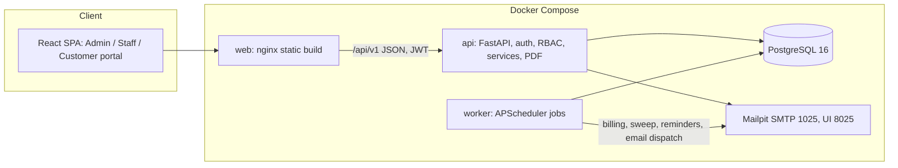
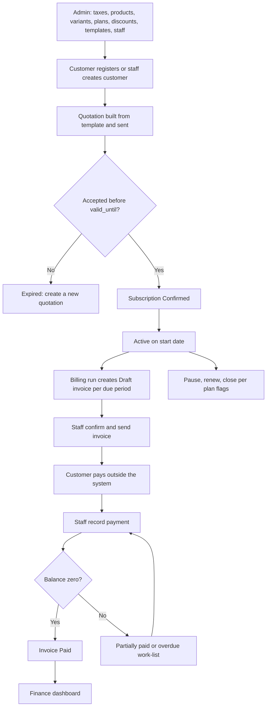
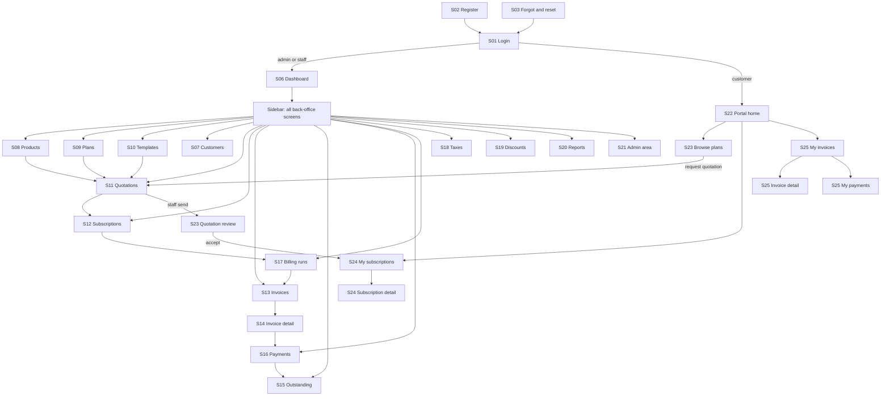
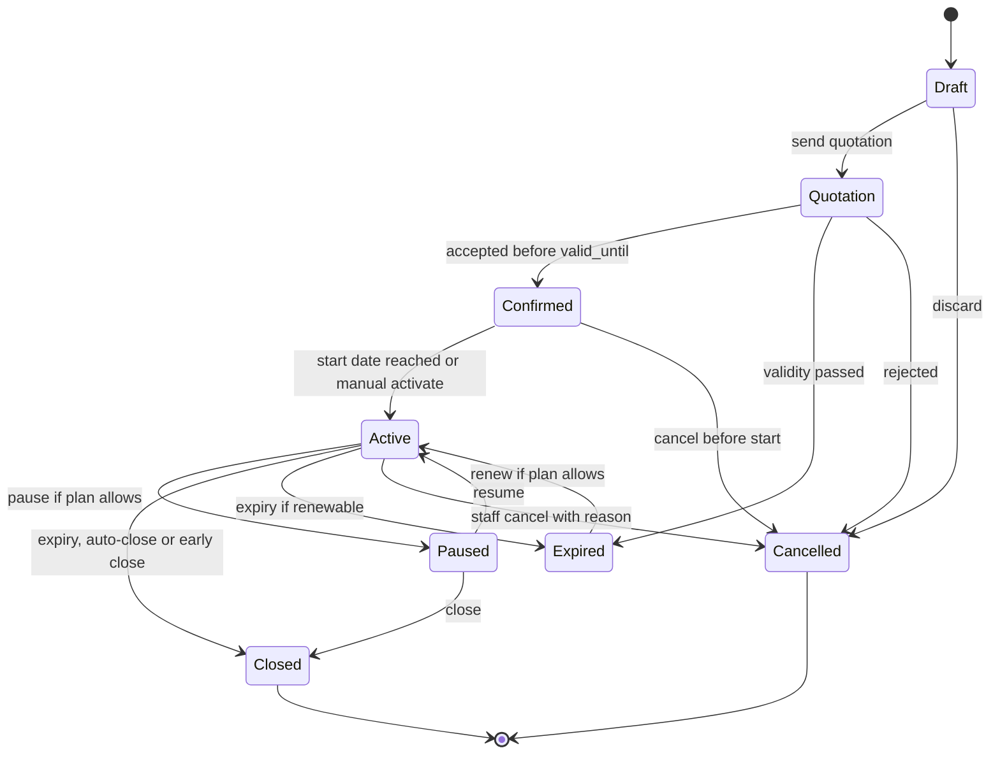
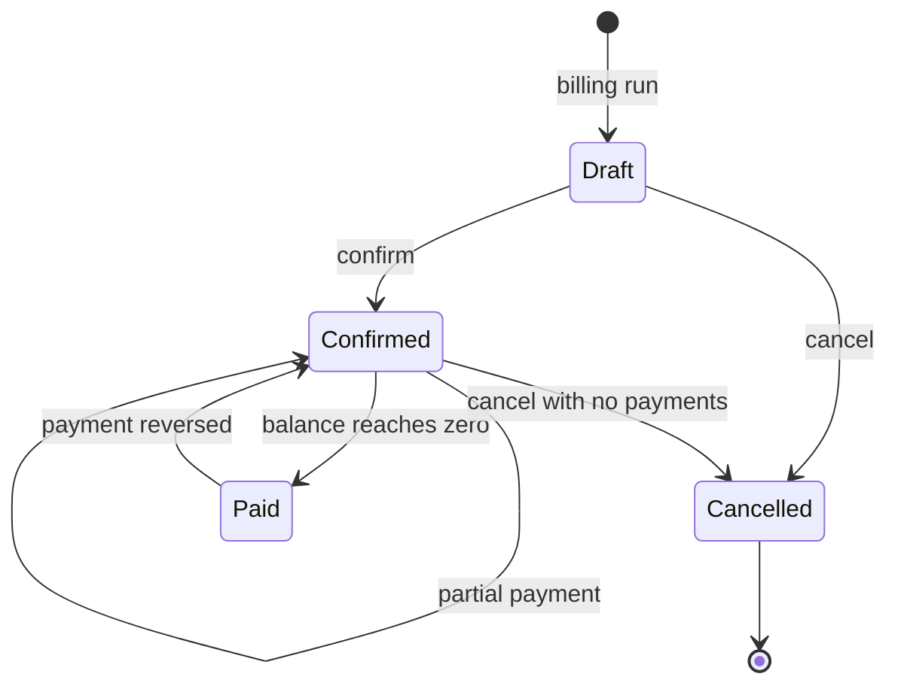
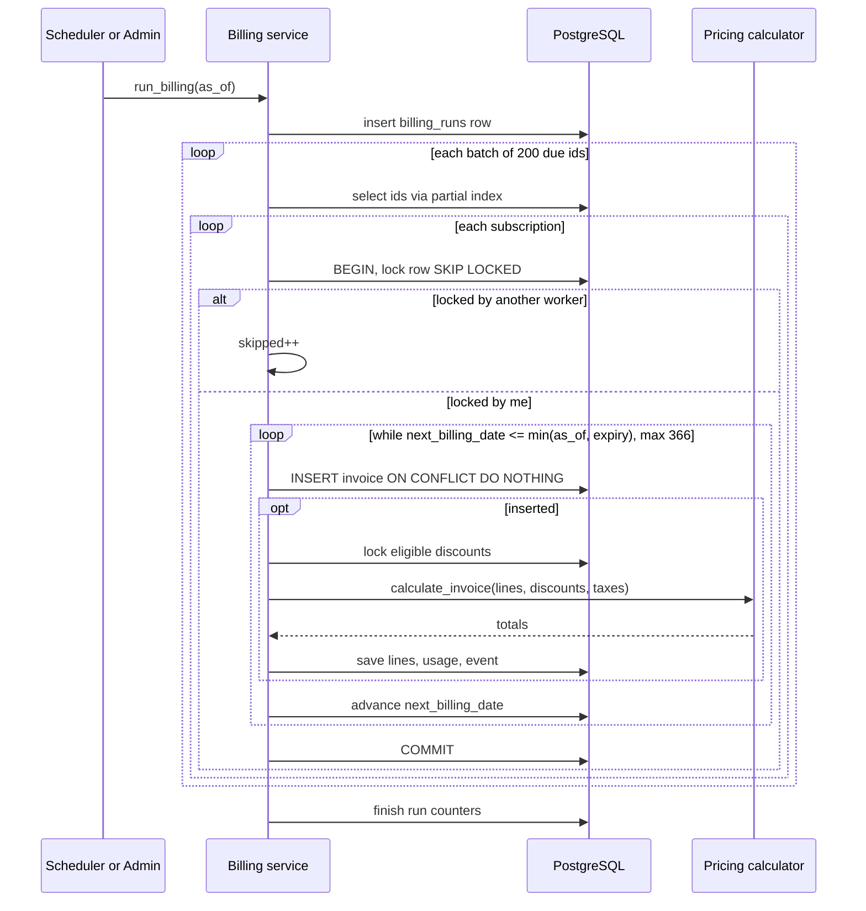
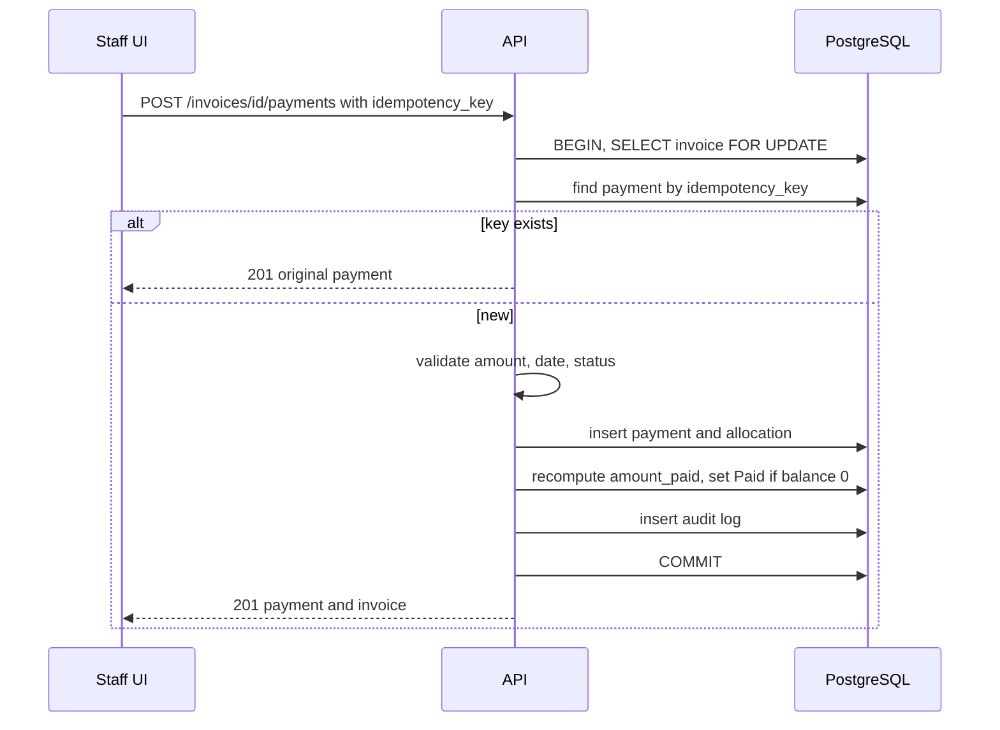
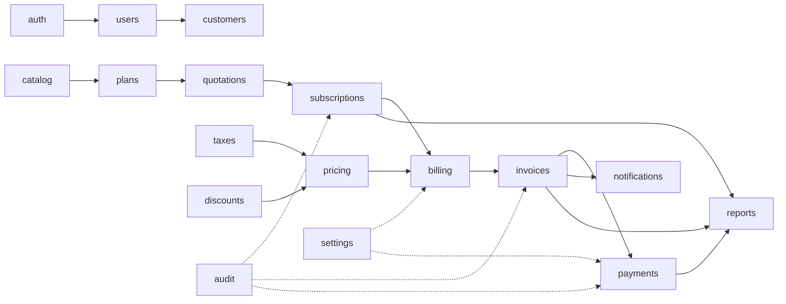
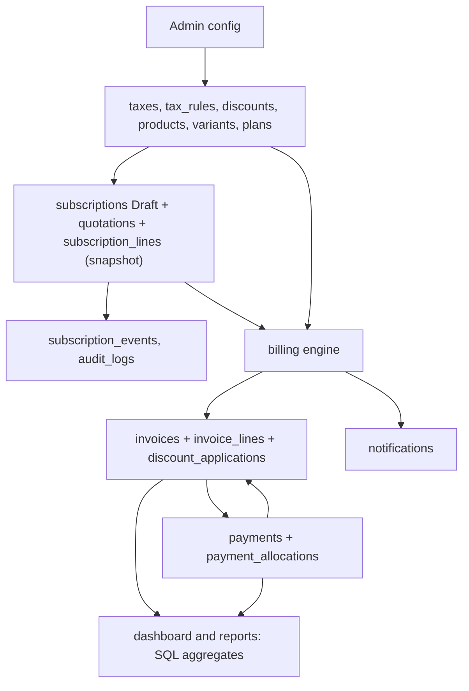
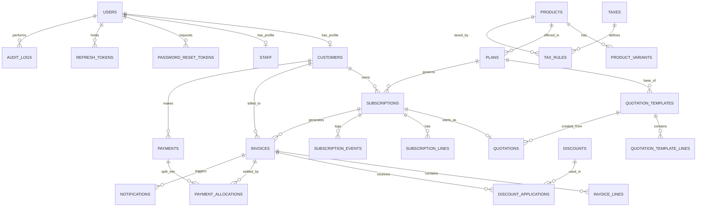

# Subscript Hub: Implementation Plan

> Derived from two source documents:
> - **PDF 1** "Subscript Hub: Screen list and flow" (cited as **SL §n**): screens S0–S25, page IDs P01–P37, two flow diagrams.
> - **PDF 2** "Subscript Hub: Engineering Blueprint" (cited as **BP §n**): requirements, architecture, DB, API, billing engine, UI, security, tests, UI-generation prompts.
>
> **Labelling convention used throughout**
> - **[EXPLICIT]**: stated in a PDF.
> - **[INFERRED]**: not stated, but required by the workflow or by consistency between the PDFs.
> - **[RECOMMENDATION]**: my proposal, needs team approval.
> - **[ASSUMPTION-BP]**: an assumption the Blueprint itself marks `[ASSUMPTION]` and asks the team to confirm (BP §18).

---

## Table of Contents
1. Project overview
2. Document analysis (how the two PDFs connect, conflicts found)
3. System architecture
4. Module breakdown
5. Functional requirements
6. Workflow explanations
7. State transition tables
8. Mermaid diagrams
9. Recommended folder structure
10. File-level responsibilities
11. Function-level specifications
12. Database design
13. API specifications
14. Detailed implementation phases
15. Testing strategy
16. Requirement traceability matrix
17. Assumptions, dependencies and open questions
18. Final implementation checklist

---

## 1. Project overview

### 1.1 Objective [EXPLICIT: BP §1, §2]
Build **Subscript Hub**, one web platform that runs the whole life of a subscription business for the fictional company **Brightloop Software**. It covers products and variants, plans, quotations, subscriptions, automatic recurring invoices, taxes, discounts, payments and a finance dashboard, plus a customer self-service portal. It replaces spreadsheets, remembered renewals, hand-typed invoices and manual bank matching.

### 1.2 The three hardest problems (get right first) [EXPLICIT: BP §1]
1. **Recurring billing engine**: idempotent (never bill twice), complete (never skip a cycle), transaction-safe.
2. **Money maths**: exact `DECIMAL`/`NUMERIC`, never float; fixed rounding; partial payments.
3. **Access control**: a customer must never see another customer's data, even by editing an ID in the URL.

### 1.3 Users and roles [EXPLICIT: BP §2.3, SL §1]
| Role | Who | Scope |
|---|---|---|
| Admin | Owner / ops head | Everything, including staff, taxes, discounts, settings, audit |
| Staff | Sales and support | Day-to-day ops. No staff creation, no tax/discount/product/plan writes, no settings/audit. Cannot reverse payments |
| Customer | Small shop / large company | Own data only via `/me/*`. Allowed actions per plan flags |
| Finance lead | Reviews numbers | Not a fourth role: an Admin or Staff user [ASSUMPTION-BP #1] |

### 1.4 Scope tiers [EXPLICIT: BP §3, §15.4]
- **Must (M)**: everything labelled M in BP §3 (auth, RBAC, catalogue, plans, quotation → subscription lifecycle, billing engine, tax, discount, payments, dashboard, performance, dynamic data, responsive UI, validation, navigation, Git workflow).
- **Should (S)**: offline/local-first (FR-K6), partial payments (FR-X1), audit log (FR-X2), overdue reminders (FR-X3).
- **Could (C)**: CSV export (FR-X4).
- **Future (F)**: real payment gateway, proration, multi-currency, usage billing, dunning, credit notes/refunds, SSO, Redis, Prometheus/Grafana (FR-X5).
- **Real / Mocked**: online payment collection is MOCKED/FUTURE. Any "Pay now" button must be labelled *Simulated* (BP §15.4). Email is REAL only if SMTP is configured, otherwise captured in Mailpit.

### 1.5 Technology stack [EXPLICIT: BP §6.2, §16.1]
The stack **is specified** in the Blueprint, so it is a documented requirement and not my recommendation.
- Frontend: React 18, TypeScript (strict), Vite, Tailwind, shadcn/ui (Radix), TanStack Query v5, React Hook Form + Zod, React Router v6, Recharts, lucide-react, `@fontsource` (self-hosted fonts).
- Backend: FastAPI, Pydantic v2, SQLAlchemy 2, Alembic, APScheduler (separate worker container), ReportLab, argon2-cffi.
- DB: PostgreSQL 16. Packaging: Docker Compose, Mailpit. CI: GitHub Actions. Tests: pytest, Vitest, Playwright, k6.

---

## 2. Document analysis

### 2.1 What each PDF contributes
| Aspect | PDF 1 (SL) | PDF 2 (BP) |
|---|---|---|
| Role | Screen inventory and navigation flow | Business rules, data, API, engine, tests |
| Screens | S0–S25 mapped to P01–P37, plus who uses each | Page inventory §19.1, per-page build prompts §19, design prompts §20 |
| Flow | Diagram 1: login → back-office; Diagram 2: customer portal | Business workflow §2.3.1, lifecycle §9, billing §9.3 |
| Behaviour | Only high-level ("Lifecycle actions", "Creates invoices") | Complete |

### 2.2 How the two PDFs connect (diagram → function mapping)
**SL Diagram 1 (login and back-office, §2 of SL)**

| Diagram node | Meaning in the diagram | Backing module / function (BP) |
|---|---|---|
| S01 Login | "Routes by role" | `auth.login`; frontend redirect by role (admin/staff → `/dashboard`, customer → `/portal`) |
| S02 Register | "Customer signup" | `auth.register` (FR-A1) |
| S03 Forgot, reset | "Email reset link" | `auth.forgot_password`, `auth.reset_password` (FR-A3) |
| S06 Dashboard | "Admin and staff home" | `reports.dashboard_*` (FR-I1/I2) |
| S22 Portal home | "Customer, diagram 2" | `/me/*` aggregates |
| S08 Products | "Variants, price" | `catalog` (FR-B1/B2) |
| S09 Plans | "Billing period" | `plans` (FR-C1/C2) |
| S10 Templates | "Quote presets" | `quotations.templates` (FR-D1) |
| S07 Customers | "List and detail" | `customers` |
| S11 Quotations | "Build and send" | `quotations.send/confirm` (FR-D2) |
| S12 Subscriptions | "Lifecycle actions" | `subscriptions.transition` (FR-D3–D5) |
| S14 Invoice detail | "Send, print, pay" | `invoices.confirm/send/pdf`, `payments.record` (FR-E5–E7, H1) |
| S13 Invoices | "Review, confirm" | `invoices.bulk_confirm` |
| S17 Billing runs | "Creates invoices" | `billing.run_billing` (FR-E1–E4) |
| S16 Payments | "Record payment" | `payments.record_payment` |
| S15 Outstanding | "Overdue work-list" | derived overdue query (FR-H3) |
| S20 Reports | "Export CSV" | `reports.*` (FR-X4) |
| S18 Taxes | "Rates and rules" | `taxes` (FR-F1) |
| S19 Discounts | "Rules, usage limits" | `discounts` (FR-G1/G2) |
| S21 Admin area | "Staff, logs, settings" | `users.staff`, `audit`, `settings` |

The diagram's closing sentence is the **business sequence**: *catalogue (S08, S09, S10) → quotations (S11) → confirmed quotation becomes a subscription (S12) → billing runs (S17) create invoices (S13, S14) → payments (S16) and overdue list (S15) close the loop.* This is the backbone of the implementation phase order.

**SL Diagram 2 (customer portal, §3 of SL)**
`S01 Login → S22 Portal home → {S23 Browse plans, S24 My subscriptions, S25 My invoices}`. Handoff: the customer requests a quotation in S23 → staff review and send in S11 → the customer reviews and accepts in S23 (Quotation review) → this creates the subscription shown in S24. Subscription detail offers Pause/Renew/Close; invoices and payments in S25 are **read-only** (PDF download and print only).

### 2.3 Screen to page to route reconciliation [EXPLICIT: SL §1 + BP §19.1]
| Screen | Pages | Routes | Roles |
|---|---|---|---|
| S01 | P01 | `/login` | Public |
| S02 | P02 | `/register` | Public |
| S03 | P03, P04 | `/forgot-password`, `/reset-password?token=` | Public |
| S04 | P05 | `/forbidden`, `*` | All |
| S05 | P06 | `/profile`, `/portal/profile` | All |
| S06 | P07 | `/dashboard` | A, S |
| S07 | P08, P09 | `/customers`, `/customers/:id` | A, S |
| S08 | P10, P11 | `/products`, `/products/new`, `/products/:id` | A (S read-only) |
| S09 | P12, P13 | `/plans`, `/plans/new`, `/plans/:id` | A (S read-only) |
| S10 | P14 | `/quotation-templates` | A, S |
| S11 | P15, P16 | `/quotations`, `/quotations/new`, `/quotations/:id` | A, S |
| S12 | P17, P18 | `/subscriptions`, `/subscriptions/:id` | A, S |
| S13 | P19 | `/invoices` | A, S |
| S14 | P20, P36 | `/invoices/:id`, `/portal/invoices/:id` | A, S, C |
| S15 | P21 | `/invoices/outstanding` | A, S |
| S16 | P22 | `/payments` (+ shared RecordPaymentDrawer) | A, S |
| S17 | P23 | `/billing` | A runs, S views |
| S18 | P24 | `/taxes` | A (S read-only) |
| S19 | P25 | `/discounts` | A (S read-only) |
| S20 | P26 | `/reports` | A, S |
| S21 | P27, P28, P29 | `/staff`, `/audit-log`, `/settings` | A only |
| S22 | P30 | `/portal` | C |
| S23 | P31, P32 | `/portal/plans`, `/portal/quotations/:id` | C |
| S24 | P33, P34 | `/portal/subscriptions`, `/portal/subscriptions/:id` | C |
| S25 | P35, P36, P37 | `/portal/invoices`, `/portal/invoices/:id`, `/portal/payments` | C |

Note: SL §1 says the route table is "Section 19" and the screen prompts "Section 20.3". Those match BP §19.1 and BP §20.3. P36 is shared by S14 (portal variant) and S25. S0 is the Stitch design-system prompt D0, not a page.

### 2.4 Conflicts, gaps and inconsistencies found between and within the PDFs
Each of these is repeated in §17 with impact.

| # | Finding | Where |
|---|---|---|
| C1 | P31 (customer quotation request) calls `POST /quotations`, but BP §8.5 restricts that endpoint to Admin/Staff | BP §19 P31 vs §8.5 |
| C2 | P32 (quotation review) uses `GET /me/subscriptions/{id}` and `POST /quotations/{id}/confirm`. BP §8.5 allows Customer on confirm "via portal link", but no customer-scoped confirm or `/me/quotations` endpoint exists | BP P32 vs §8.5 |
| C3 | P34 needs `GET /me/invoices?subscription_id=` and an `available_actions` field; neither is in §8.6/8.7. BP §19.8 itself flags this | BP P34 |
| C4 | P09 calls `GET /payments?customer_id=`, but §8.8 lists `method, from, to, invoice_id` filters only | BP P09 vs §8.8 |
| C5 | P36 wants public payment details via `GET /settings` (admin-only in §8.9) | BP P36 vs §8.9 |
| C6 | P08/P09 need `active subscriptions count` and `outstanding balance` on the customer list/detail ("profile + counts" only loosely defined) | BP P08 vs §8.3 |
| C7 | Quotation lines: the template lists `quotation_lines`, but the design stores lines in `subscription_lines` | BP §7.1 (documented as assumption) |
| C8 | P28/P29/P05: P29 Settings is Priority "C" in §19.1 while the settings values (auto-confirm, auto-paid, overpayment policy) are needed by billing and payments | BP §19.1 vs §9.3, §5 #30 |
| C9 | §6.6 says "4 containers" but lists web, api, worker, db plus mailpit (5) | BP §6.6 |
| C10 | Subscription number format is `SUB2026-000123` in FR-D3 but `SUB-2026-000123` in §7.1 and UI | BP §3 vs §7 |
| C11 | Test IDs written `TC01` in §14.2 and `TC-01` in §17 | BP §14/§17 |
| C12 | "Paid vs unpaid invoices" KPI (P07) has no matching field in `/dashboard/summary` description | BP P07 vs §8.9 |
| C13 | Lifecycle diagram has transition `Active → Expired (renewable)`, but allowed actions list in §8.6 has no `expire` action (system-only) | BP §9.2 vs §8.6 |
| C14 | Invoice `Overdue` is derived, never stored, but the `?status=` filter on P19/P35 treats it as a chip. Needs a defined mapping to `overdue=true` | BP §5 #2, P19 |
| C15 | P21 "Send reminder email" reuses `POST /invoices/{id}/send`, which semantically sends the invoice PDF, not a reminder | BP P21 |
| C16 | `invoice.status` enum has only `draft, confirmed, paid, cancelled`, so "Partially paid" is derived from `amount_paid > 0 and balance > 0` | BP §7.2 |
| C17 | `payments` has `customer_id` but allocation targets invoices, so payment ↔ invoice link for list display (P22 "invoice number") comes via `payment_allocations` | BP §7.2 |

---

## 3. System architecture

### 3.1 Style [EXPLICIT: BP §6]
Modular monolith: one FastAPI codebase, one PostgreSQL DB, one extra process (worker). No microservices, broker, Redis or Kubernetes.

### 3.2 Runtime components
| Component | Technology | Responsibility |
|---|---|---|
| `web` | React SPA built by Vite, served by nginx | UI for all 3 roles, one layout shell |
| `api` | FastAPI + uvicorn | REST `/api/v1`, auth, RBAC, business services, PDF on demand |
| `worker` | APScheduler | Jobs: `run_billing`, `sweep_lifecycle`, `dispatch_notifications`, `overdue_reminders` |
| `db` | PostgreSQL 16, volume `pgdata` | Single source of truth; queue for notifications and row-lock coordination |
| `mailpit` | Mailpit | Local SMTP `:1025`, inbox UI `:8025` |

### 3.3 Cross-cutting design rules [EXPLICIT]
- Routers contain **no** business logic. Services do. `pricing` and the billing engine are pure functions callable without HTTP.
- Money: `NUMERIC(14,2)` / `Decimal`; money in JSON as **strings** with 2 decimals; percentages `NUMERIC(5,2)`.
- IDs: UUID v4 PKs; human numbers (`SUB-…`, `INV-…`, quotation number) are separate unique columns from PostgreSQL sequences.
- Snapshots: prices and tax rates copied onto subscription lines and again onto invoice lines.
- Soft delete for catalogue/customers/taxes/discounts; financial rows never deleted.
- Dates stored as `DATE` in business timezone `Asia/Kolkata`; timestamps UTC [ASSUMPTION-BP #9].
- Validation three layers: Zod (client), Pydantic (server), DB constraints.
- Auth: JWT access (15 min, in memory on client) + rotating refresh token in httpOnly cookie; argon2id.
- Default-deny RBAC: every route has `require_roles(...)`; a test fails if a route lacks it.
- Performance budget: < 2 s per page with 10,000 subscriptions / 100,000 invoices / 120,000 payments.

### 3.4 Data flow summary
1. Admin config (taxes, products, variants, plans, discounts, templates) → catalogue tables.
2. Quotation creation → `subscriptions` (Draft) + `quotations` + `subscription_lines` (price snapshot).
3. Lifecycle transition → `subscriptions.status` + `subscription_events` + `audit_logs`.
4. Billing run → `invoices` + `invoice_lines` + `discount_applications` + `discounts.usage_count` + `subscriptions.next_billing_date` + `notifications`, one transaction per subscription.
5. Payment → `payments` + `payment_allocations` → `invoices.amount_paid` → status `paid` at balance 0.
6. Dashboard/reports read aggregates (SQL `COUNT/SUM`) from invoices, payments, subscriptions.

---

## 4. Module breakdown

The 20 modules from BP §16.3, each tied to its backend package, frontend feature and screens.

| # | Module | Backend package | Frontend feature | Screens/pages | Phase |
|---|---|---|---|---|---|
| 1 | Auth and session | `modules/auth` | `features/auth` | S01–S05; P01–P06 | 2 |
| 2 | Users and staff | `modules/users` | `features/staff` | S21 (P27) | 2 |
| 3 | Customers | `modules/customers` | `features/customers` | S07 (P08, P09) | 3 |
| 4 | Product catalogue and variants | `modules/catalog` | `features/products` | S08 (P10, P11) | 3 |
| 5 | Plans | `modules/plans` | `features/plans` | S09 (P12, P13) | 3 |
| 6 | Quotation templates | `modules/quotations` (templates) | `features/templates` | S10 (P14) | 4 |
| 7 | Quotations | `modules/quotations` | `features/quotations` | S11 (P15, P16) | 4 |
| 8 | Subscriptions and lifecycle | `modules/subscriptions` | `features/subscriptions` | S12 (P17, P18) | 4 |
| 9 | Pricing calculator (tax + discount) | `pricing/` | none (display only) | n/a | 5 |
| 10 | Billing engine and scheduler | `modules/billing`, `worker/` | `features/billing` | S17 (P23) | 5 |
| 11 | Invoices | `modules/invoices` | `features/invoices` | S13, S14, S15 (P19–P21) | 5 |
| 12 | Taxes and tax rules | `modules/taxes` | `features/taxes` | S18 (P24) | 5 |
| 13 | Discounts | `modules/discounts` | `features/discounts` | S19 (P25) | 5 |
| 14 | Payments and allocations | `modules/payments` | `features/payments` | S16 (P22) | 6 |
| 15 | Dashboard and reports | `modules/reports` | `features/dashboard`, `features/reports` | S06, S20 (P07, P26) | 7 |
| 16 | Notifications (email queue) | `modules/notifications` | n/a | n/a | 5 |
| 17 | Audit log | `modules/audit` | `features/audit` | S21 (P28) | 3 |
| 18 | Settings | `core` + `modules/settings` | `features/settings` | S21 (P29) | 3 |
| 19 | Customer portal | `/me/*` routes in owning modules | `features/portal` | S22–S25 (P30–P37) | 8 |
| 20 | Seed and demo tooling | `scripts/seed.py` | n/a | n/a | 1 / 9 |

[RECOMMENDATION] Put `/me/*` routers inside the owning module (e.g. `subscriptions/router_me.py`) instead of a separate `portal` module, so customer-scoped queries reuse the service layer and the isolation test can enumerate them. Settings has no module in BP §6.4's list but is required by billing/payments, so I give it a small module.

### 4.1 Dependencies between modules
```
auth → users → customers
catalog → plans → quotations/templates → subscriptions
taxes, discounts → pricing → billing → invoices → payments → reports
notifications ← invoices, auth, quotations, billing (overdue_reminders)
audit ← every state-changing service
settings → billing, payments, pricing
```

---

## 5. Functional requirements

All Blueprint requirement IDs are preserved (BP §3). Priority M/S/C/F. Roles A/S/C/Sys.

### 5.1 Auth and users (FR-A)
| ID | Requirement | Role | Business rules | Acceptance | Pri |
|---|---|---|---|---|---|
| FR-A1 | Customer registration | C | One account per email, case-insensitive; role forced to Customer; email normalised (trim, lowercase) | 201 and can log in; duplicate → 409 | M |
| FR-A2 | Password policy | all | Length > 8 (min 9), ≥1 upper, ≥1 lower, ≥1 special; same rule UI and API | 8-char with all classes rejected; 9-char accepted | M |
| FR-A3 | Password reset by email | all | Random token, single-use, 30-min expiry, stored as SHA-256 hash; response never reveals email existence; sessions revoked after reset | Mail in Mailpit; link reuse fails | M |
| FR-A4 | Role-based access | all | Server-side check on every endpoint | Staff calling admin endpoint → 403 | M |
| FR-A5 | Customer data isolation | C | Queries filtered by logged-in customer; foreign ID → **404** | Customer A requesting B's invoice → 404 | M |
| FR-A6 | Only Admin creates staff | A | Staff cannot self-register or create staff | Staff `POST /staff` → 403 | M |

### 5.2 Catalogue (FR-B, FR-C)
| ID | Requirement | Role | Rules | Pri |
|---|---|---|---|---|
| FR-B1 | Product management | A | Prices ≥ 0; cost may exceed sales (warn only); name unique | M |
| FR-B2 | Variants with price adjustment | A | Variant price = base + adjustment; adjustment may be negative; snapshot at subscription time; example 1000 + Odoo(+560) = 1560 | M |
| FR-C1 | Plan management | A | Period ∈ daily/weekly/monthly/yearly; `until ≥ from`; `min_qty ≥ 1` | M |
| FR-C2 | Plan permissions | A | Flags: auto_close_on_end, allow_early_close, allow_pause, allow_renew decide actions per plan | M |
| FR-C3 | Auto-close on plan end | Sys | Only if `auto_close_on_end`; else the subscription runs to its own expiry | M |

### 5.3 Quotation and subscription (FR-D)
| ID | Requirement | Rules | Pri |
|---|---|---|---|
| FR-D1 | Quotation templates | validity > 0 days; name unique; non-empty lines | M |
| FR-D2 | Individual quotations | `valid_until = created + validity_days`; lines editable before sending | M |
| FR-D3 | Subscription record | Unique number `SUB-YYYY-NNNNNN`; line total = qty × unit price + tax | M |
| FR-D4 | Lifecycle Draft→Quotation→Confirmed→Active→Closed | Only allowed transitions; each logged in `subscription_events`; illegal → 409 | M |
| FR-D5 | Pause and renew | Only if plan permits; pause stops billing; renew extends expiry | M |

### 5.4 Billing and invoices (FR-E)
| ID | Requirement | Rules | Pri |
|---|---|---|---|
| FR-E1 | Find due subscriptions | `status='active' AND next_billing_date <= as_of AND next_billing_date <= expiry_date` | M |
| FR-E2 | Auto-generate invoices | Customer, lines, taxes, discounts, totals auto-filled; created as Draft | M |
| FR-E3 | No duplicate / no missed billing | Unique `(subscription_id, period_start)` WHERE not cancelled; catch-up loop | M |
| FR-E4 | Bulk processing | Batches of 200, one transaction per subscription, isolated failures; 500 subs, 0 duplicates | M |
| FR-E5 | Invoice lifecycle Draft→Confirmed→Paid | Paid only at balance 0; confirmed invoices immutable except cancel | M |
| FR-E6 | Cancel invoice | Draft/Confirmed with no payments; reason required | M |
| FR-E7 | Send and print invoice | PDF generated locally; email queued in `notifications` | M |

### 5.5 Tax, discount (FR-F, FR-G)
| ID | Requirement | Rules | Pri |
|---|---|---|---|
| FR-F1 | Tax configuration | Rate 0–100; scope all/product/product_type; inclusive flag (FUTURE use); change affects future invoices only | M |
| FR-F2 | Automatic tax + breakdown | Round per line HALF_UP to 2 dp; invoice total = sum of line totals | M |
| FR-G1 | Discount rules (Admin only) | fixed/percent; percent 0–100; min amount, min qty, start, end, max uses, scope product/subscription; staff → 403 | M |
| FR-G2 | Auto-apply discounts | Applied on next invoice; stops at end date or when `usage_count = max_usage` | M |

### 5.6 Payments (FR-H)
| ID | Requirement | Rules | Pri |
|---|---|---|---|
| FR-H1 | Record payment | amount > 0 and ≤ balance; invoice must be Confirmed; date not in future; idempotency key | M |
| FR-H2 | Payment methods | cash, bank_transfer, upi, card, cheque (+ `other` in the enum); recorded, not processed | M |
| FR-H3 | Payment status views | paid, unpaid, partially paid, outstanding, overdue (= confirmed ∧ due_date < today ∧ balance > 0) | M |

### 5.7 Dashboard and quality (FR-I, FR-J, FR-K)
| ID | Requirement | Pri |
|---|---|---|
| FR-I1 | Finance dashboard: active subs, revenue received, outstanding, overdue count/amount, trends | M |
| FR-I2 | Filters (date range, plan, status) change KPIs | M |
| FR-J1 | p95 < 2 s per page at 10k subs | M |
| FR-K1 | Dynamic data only: no static JSON at runtime; seed via DB script | M |
| FR-K2 | Responsive, consistent UI at 360 / 768 / 1280 px | M |
| FR-K3 | Robust validation client + server + DB | M |
| FR-K4 | Intuitive navigation, every screen ≤ 3 clicks, role-based sidebar, breadcrumbs | M |
| FR-K5 | Team Git workflow, every member commits | M |
| FR-K6 | Offline/local-first (`docker compose up` with WiFi off) | S |

### 5.8 Extras (FR-X)
| ID | Requirement | Pri |
|---|---|---|
| FR-X1 | Partial payments (invoice stays Confirmed, `amount_paid` updated) | S |
| FR-X2 | Audit log (who, what, when, before/after) | S |
| FR-X3 | Overdue reminder emails (one per N days) | S |
| FR-X4 | CSV export of reports | C |
| FR-X5 | Gateway, proration, multi-currency, usage billing, dunning | F |

### 5.9 Hidden requirements (BP §5, 42 edge cases) [EXPLICIT]
Treated as requirements and mapped in §16. Key ones: E-1 payment bounce/reversal (#1), E-2 derived overdue (#2), E-3 expiry sweep (#3), E-4 plan change = close old + new (#4), E-5 pause/resume date shift (#5, #6), E-6 discount expiry/limit/race (#7–9), E-7 partial/over/duplicate payment (#10–12), E-8 job twice / two workers (#13, #14), E-9 snapshot rules (#15–17), E-10 cancel semantics (#18, #34), E-11 renew after expiry (#19), E-12 plan available-until (#20), E-13 catch-up (#21), E-14 month-end anchor (#22), E-15 quantity below min (#23), E-16 expired quotation confirm (#24), E-17 email normalisation (#25), E-18 token reuse (#26), E-19 deactivated user (#27), E-20 IDOR (#28), E-21 discount > subtotal (#29), E-22 zero-total invoice (#30), E-23 tax-exempt (#31), E-24 rounding (#32), E-25 back-dated start (#33), E-26 soft delete (#35), E-27 last admin (#36), E-28 timezone (#37), E-29 concurrent payments (#38), E-30 email failure retry (#39), E-31 confirmed invoice immutable (#40), E-32 customer deletion = soft deactivate (#41), E-33 brute force (#42).

### 5.10 Inferred requirements [INFERRED]
| ID | Inferred requirement | Why |
|---|---|---|
| IR-1 | Customer-scoped quotation request endpoint (`POST /me/quotation-requests`) | P31 needs customers to create a Draft; `POST /quotations` is staff-only (C1) |
| IR-2 | Customer-scoped quotation accept (`POST /me/quotations/{id}/accept`) + `GET /me/quotations/{id}` | P32 (C2) |
| IR-3 | `available_actions` array in staff and portal subscription detail | P18, P34 |
| IR-4 | `subscription_id` filter on `/me/invoices` | P34 |
| IR-5 | `customer_id` filter on `/payments` | P09 |
| IR-6 | Public settings endpoint `GET /settings/public` (company name, payment instructions) | P36 |
| IR-7 | Customer list/detail aggregates (`active_subscriptions`, `outstanding`, `total_billed`, `total_paid`, `overdue`) | P08, P09 |
| IR-8 | `POST /billing/runs/{id}/retry-failed` | P23 "Retry failed" |
| IR-9 | `GET /billing/runs/{id}` (poll one run) | P23 polls every 2 s; list polling also works |
| IR-10 | `derived_status` and `payment_state` (unpaid/partial/paid/overdue) on invoice list rows | P19, P35 chips |
| IR-11 | `GET /dashboard/summary` returns `paid_invoice_count`, `unpaid_invoice_count`, `paid_pct` | P07 KPI "Paid vs unpaid" (C12) |
| IR-12 | `GET /me/dashboard` or composed calls for P30 | P30 uses 3 existing calls, so no new endpoint needed |
| IR-13 | `POST /payments/{id}/reverse` writes audit and restores status | FR-H1, edge #1 |
| IR-14 | Forced password change on first login for staff with temp password | P27 note "Staff must change this password at first login"; needs `must_change_password` flag |
| IR-15 | `/me/payments` includes invoice number via allocations | P37 |
| IR-16 | Activation sweep of Confirmed subscriptions whose `start_date` arrived | BP §6.5 `sweep_lifecycle` |

---

## 6. Workflow explanations

### W1. Authentication and role routing (S01–S05; FR-A1–A6)
1. Visitor opens `/login`. `POST /auth/login` returns an `access_token` (in memory) and sets an httpOnly refresh cookie.
2. `AuthProvider` calls `GET /auth/me`. Redirect: admin/staff → `/dashboard`; customer → `/portal`; or back to the originally requested URL.
3. Any 401: one refresh attempt (`POST /auth/refresh`) then retry; if that fails → `/login`.
4. 403 → `/forbidden`. 404 on a record → inline `RecordNotFound`. 429 → "Too many attempts".
5. Register: client Zod checks, `POST /auth/register`; 409 shows a field error on email.
6. Forgot: always show the same message; 60-second UI cooldown. Reset: `?token=` missing → invalid-link state; 400/410 → expired state.

### W2. Catalogue setup (Admin) (S08, S09, S10, S18, S19)
Admin creates taxes → tax rules → products → variants → plans (with four permission flags) → discount rules → quotation templates. Staff see Products, Plans, Taxes, Discounts read-only (no controls rendered; server still returns 403).

### W3. Quotation → Subscription (S11, S23; FR-D1–D4)
1. *Staff path*: P16 builds a quotation from a template (optional) → server creates `subscriptions` (Draft) + `quotations` + lines with price snapshots.
2. `POST /quotations/{id}/send`: Draft → Quotation, `sent_at` set, email with PDF queued. `valid_until = created + validity_days`.
3. *Customer path (SL Diagram 2)*: customer requests a quotation in S23 → Draft created for staff → staff review/send in S11 → customer opens P32, accepts → Confirmed.
4. If `valid_until` passed: confirm returns 409, status becomes Expired; staff must create a new quotation.
5. Confirmed → Active by the `sweep_lifecycle` job when `start_date` arrives or by manual `activate`. On activation set `next_billing_date = start_date` and `billing_anchor_day = start_date.day` [INFERRED from BP §9.3].

### W4. Subscription lifecycle actions (S12, S24)
`POST /subscriptions/{id}/transition {action, reason?}` (staff) or `POST /me/subscriptions/{id}/{pause|resume|renew|close}` (customer). Service locks the subscription row `FOR UPDATE`, validates (a) transition allowed (b) plan permission (c) role, applies the change, writes `subscription_events` + `audit_logs`. Illegal transition → 409; plan forbids → 403 (or 409 per BP TC13 "403/409").
- *Pause*: set `paused_at`; billing skips it.
- *Resume*: `next_billing_date += (today − paused_at)`; no catch-up for the paused window (edge #6).
- *Renew*: extends `expiry_date` by one plan term [INFERRED: the term length is not defined, see OQ-9].
- *Close*: customer/staff early close needs `allow_early_close`; admin may override with a reason.

### W5. Recurring billing run (S17; FR-E1–E4)
1. Trigger: daily 02:00 IST (worker) or `POST /billing/run` (admin; `as_of_date ≤ today`; optional `dry_run`).
2. `billing_runs` row created. Loop: fetch 200 due subscription IDs via partial index; for each, open its own transaction, `SELECT … FOR UPDATE SKIP LOCKED`.
3. Re-check state (still active, still due). For each missed cycle (cap 366): compute `period_start/end`, insert invoice `ON CONFLICT DO NOTHING`; if inserted → snapshot lines, lock eligible discounts, calculate totals, save lines and discount usage, log event, queue nothing yet (invoice is Draft).
4. Advance `next_billing_date` in the same transaction. If `> expiry_date` set `NULL`.
5. Exception → rollback that subscription only, record in `error_summary`, leave `next_billing_date` so the next run retries.
6. Finish run counters: `due, created, skipped, failed`. If setting `auto_confirm_invoices` is true, invoices are confirmed on creation.

### W6. Invoice handling (S13, S14, S15)
Draft → review → `confirm` (assigns `issue_date`, locks lines) or `bulk-confirm` (≤ 500). Confirmed → `send` (queue email with PDF), `pdf` download/print, record payment, or cancel (no payments). Confirmed + balance 0 → Paid. Overdue is a derived flag.

### W7. Payment recording (S16; FR-H1–H3, X1)
Open drawer (from P20/P21/P22) → one `idempotency_key` per drawer opening → `POST /invoices/{id}/payments` → service locks the invoice, validates, inserts payment + allocation, recomputes `amount_paid`, sets Paid at 0 balance, audit log. Duplicate key returns the original payment. Reversal (admin): payment `status='reversed'`, allocation excluded, invoice back to Confirmed.

### W8. Overdue and collections (S15)
`overdue = status='confirmed' AND due_date < today AND balance > 0`. P21 lists with tabs All / Due soon (7 days) / Overdue 1–30 / Overdue 31+. Daily 09:00 IST job queues reminder emails (Should have).

### W9. Customer self-service (S22–S25)
Home (tiles, overdue banner) → Browse plans → request quotation → review/accept → subscription appears → manage (only `available_actions`) → invoices/payments read-only with PDF and print. Never send a customer id; always `/me/*`.

### W10. Admin oversight (S21, S20, S06)
Staff management (create, activate/deactivate; cannot deactivate last active admin), audit log with before/after diff, settings, dashboard with filters, reports with CSV.

### W11. Background maintenance (worker)
| Job | Schedule | Action |
|---|---|---|
| `sweep_lifecycle` | 01:00 IST | Auto-close plans past end (flag true), expire quotations past `valid_until`, expire/close subscriptions at `expiry_date`, activate Confirmed with `start_date ≤ today` |
| `run_billing` | 02:00 IST | W5 |
| `overdue_reminders` | 09:00 IST | Queue reminders for overdue invoices |
| `dispatch_notifications` | every minute | Send pending emails; backoff 1, 5, 30 min; max 5 attempts |

---

## 7. State transition tables

### 7.1 Subscription lifecycle [EXPLICIT: BP §9.2]
| Current State | Trigger/Event | Condition | Action | Next State |
|---|---|---|---|---|
| (new) | Create quotation or direct create | Customer, plan available on start date, qty ≥ min | Create subscription + lines (snapshots), number assigned, event `created` | Draft |
| Draft | `send_quotation` | ≥ 1 line | Set `quotations.sent_at`, queue email+PDF, event | Quotation |
| Draft | `cancel` (discard) | none | Reason optional, event | Cancelled |
| Quotation | `confirm` (staff, or customer accept) | `valid_until ≥ today` | Set `accepted_at`, event | Confirmed |
| Quotation | `confirm` | `valid_until < today` | Reject with 409 | Expired (set by sweep or on rejection) |
| Quotation | sweep | `valid_until < today` | Event | Expired |
| Quotation | `cancel` (rejected) | reason | Event | Cancelled |
| Confirmed | `activate` or sweep | `start_date ≤ today` (sweep) / manual | Set `next_billing_date`, `billing_anchor_day` | Active |
| Confirmed | `cancel` | before start | Reason required | Cancelled |
| Active | `pause` | `plan.allow_pause` | `paused_at = now`, event | Paused |
| Paused | `resume` | state is Paused | Shift `next_billing_date` by pause duration, clear `paused_at` | Active |
| Paused | `close` | plan allows or admin override | Reason, event | Closed |
| Active | `close` (early) | `plan.allow_early_close` or admin override | Reason, event, stop billing | Closed |
| Active | sweep (expiry) | `expiry_date < today` and `plan.allow_renew` | Event | Expired |
| Active | sweep (expiry / plan end) | `expiry_date < today` (renewal not allowed) or (`plan.available_until` passed and `auto_close_on_end`) | Event `plan_closed`/`status_changed` | Closed |
| Expired | `renew` | `plan.allow_renew` and plan still available | Extend expiry, resume billing, link/new subscription per edge #19 | Active |
| Active | `cancel` (staff) | reason required | Event | Cancelled |
| any other | any other action | n/a | HTTP 409 | unchanged |

Terminal states: **Closed, Cancelled** (and **Expired** if not renewable). Any pair not in the table is illegal (409).

### 7.2 Invoice lifecycle [EXPLICIT: BP §7.2, §9.5]
| Current State | Trigger/Event | Condition | Action | Next State |
|---|---|---|---|---|
| (new) | Billing run / manual generate | Not already existing for `(subscription, period_start)` | Insert invoice + lines, discount usage, tax | Draft |
| Draft | `confirm` | Draft only | Assign `issue_date`, lock lines | Confirmed |
| Draft | `bulk-confirm` | ≤ 500 ids | Same per invoice; skipped with reasons | Confirmed |
| Draft | `cancel` | reason | `cancelled_at`, audit | Cancelled |
| Confirmed | `record payment` partial | `0 < amount < balance` | Payment + allocation, `amount_paid += amount` | Confirmed (derived *Partially paid*) |
| Confirmed | `record payment` full | `amount = balance` | same | Paid |
| Confirmed | `cancel` | No active payments | audit | Cancelled |
| Confirmed | `send` | status Confirmed | queue notification | Confirmed |
| Confirmed | zero-total on confirm | `total = 0` and setting auto-paid on | set paid [ASSUMPTION-BP #10] | Paid |
| Paid | `reverse payment` | Admin | Allocation excluded, `amount_paid` recomputed | Confirmed |
| Paid | `cancel` | any | Rejected | Paid |
| Confirmed/Paid | edit | any | Rejected 409 | unchanged |

**Derived flags (never stored):** Overdue = Confirmed ∧ `due_date < today` ∧ `balance > 0`; Partially paid = Confirmed ∧ `amount_paid > 0` ∧ `balance > 0`.

### 7.3 Payment [EXPLICIT: BP §7.2 `payment_status`]
| Current State | Trigger/Event | Condition | Action | Next State |
|---|---|---|---|---|
| (new) | Record | Invoice Confirmed; `0 < amount ≤ balance`; date ≤ today | Insert payment + allocation | recorded |
| (new) | Duplicate idempotency key | Same key | Return original payment | unchanged |
| recorded | Reverse | Admin, reason | Restore invoice balance, audit | reversed |
| recorded | Mark failed (cheque bounce) | Admin | Same effect as reverse, status `failed` | failed |

### 7.4 Quotation (derived from subscription state) [INFERRED]
Quotation rows have `sent_at`, `accepted_at`, `valid_until`; their displayed status is the subscription status (Draft / Quotation / Confirmed / Expired). P15 filters `draft, quotation, confirmed, expired`.

### 7.5 Password reset token
| Current State | Trigger | Condition | Action | Next State |
|---|---|---|---|---|
| (none) | `forgot-password` | Any email (same 202 response) | If user exists: create hashed token (30 min), queue email | issued |
| issued | `reset-password` | Hash found, not used, not expired, password policy ok | Update password, set `used_at`, invalidate all other tokens, revoke refresh tokens | used |
| issued | `reset-password` | expired / used / unknown | Generic 400 | unchanged |

### 7.6 Notification
| Current State | Trigger | Condition | Action | Next State |
|---|---|---|---|---|
| pending | dispatcher tick | `next_attempt_at ≤ now` | Send SMTP | sent |
| pending | send fails | `attempts < 5` | `attempts++`, `next_attempt_at` = now + 1/5/30 min | pending |
| pending | send fails | `attempts = 5` | store `last_error` | failed |

### 7.7 Billing run
| Current State | Trigger | Action | Next State |
|---|---|---|---|
| (new) | manual or scheduled start | Create row, `started_at` | running |
| running | batches done | Set counters, `finished_at` | finished (with `failed_count ≥ 0`) |
| running | fatal error | `error_summary` | failed [INFERRED] |
| finished | Retry failed (admin) | New run limited to failed subscription ids | running |

### 7.8 Discount (derived chip) [EXPLICIT: BP P25]
Scheduled (`start_date > today`), Active (`is_active` ∧ in date window ∧ `usage_count < max_usage`), Expired (`end_date < today`), Exhausted (`usage_count = max_usage`). Computed on read.

### 7.9 UI route-guard flow
| Current State | Trigger | Condition | Action | Next State |
|---|---|---|---|---|
| Anonymous | Open protected route | no session | Save target URL | `/login` |
| Anonymous | Login success | role = admin/staff | Redirect | `/dashboard` (or saved URL) |
| Anonymous | Login success | role = customer | Redirect | `/portal` (or saved URL) |
| Authenticated | Open route not allowed for role | `RequireAuth roles` mismatch | Redirect | `/forbidden` |
| Authenticated | API 401 | refresh fails | Clear store | `/login` |
| Authenticated | API 404 on record | any | Show `RecordNotFound` | same route |
| Authenticated | Logged in visits `/login` | any | Redirect by role | home |

---

## 8. Mermaid diagrams

### 8.1 System architecture


### 8.2 Main business workflow


### 8.3 Navigation flow (SL Diagram 1 and 2 combined)


### 8.4 Subscription state machine


### 8.5 Invoice and payment state machine


### 8.6 Billing engine sequence


### 8.7 Payment sequence


### 8.8 Module interaction


### 8.9 Data flow


### 8.10 ER diagram (from BP §7.3, completed with relations stated in §7.2)


---

## 9. Recommended folder structure

The top-level tree is **[EXPLICIT: BP §16.5]**. Files inside each module and the items marked ★ are **[RECOMMENDATION]** expansions I derived from the 14 backend modules and the 37 pages. Nothing here changes the stack.

```
subscript-hub/
├── docker-compose.yml            # db, api, worker, web, mailpit
├── Makefile                      # up | demo | test | seed | reset
├── .env.example  .gitignore  README.md
├── .github/workflows/ci.yml      # ruff, mypy, pytest, eslint, tsc, vitest, pip-audit, npm audit
├── docs/                         # blueprint, ER, performance.md, demo-script.md,
│   ├── frontend-context.md       #   Prompt 0 (BP §19.3) saved for AI agents
│   └── design/                   #   Stitch exports named P07-dashboard.png etc. (BP §20.1)
├── backend/
│   ├── Dockerfile  pyproject.toml  alembic.ini
│   ├── alembic/versions/
│   ├── scripts/seed.py           # DB seed (10k subs, 100k invoices, 120k payments)
│   ├── app/
│   │   ├── main.py               # app factory, router mounting, middleware
│   │   ├── core/
│   │   │   ├── config.py  db.py  security.py  rbac.py  errors.py
│   │   │   ├── logging.py  ratelimit.py  cache.py  numbering.py ★
│   │   │   └── deps.py ★         # current_user, current_customer, require_roles
│   │   ├── modules/
│   │   │   ├── auth/             # router, schemas, service, models
│   │   │   ├── users/            # staff CRUD
│   │   │   ├── customers/
│   │   │   ├── catalog/          # products, variants
│   │   │   ├── plans/
│   │   │   ├── quotations/       # quotations + templates (router_templates.py ★)
│   │   │   ├── subscriptions/    # router.py, router_me.py ★, state_machine.py ★, service.py
│   │   │   ├── billing/          # engine.py ★, dates.py ★ (add_period), service.py, router.py
│   │   │   ├── invoices/         # router, router_me ★, service, pdf.py ★
│   │   │   ├── taxes/
│   │   │   ├── discounts/
│   │   │   ├── payments/         # router, router_me ★, service
│   │   │   ├── reports/          # dashboard.py ★, reports.py ★, csv.py ★
│   │   │   ├── notifications/    # service, templates ★, smtp.py ★
│   │   │   ├── audit/
│   │   │   └── settings/ ★
│   │   ├── pricing/              # calculator.py, rounding.py ★, eligibility.py ★ (pure)
│   │   └── worker/               # scheduler.py, jobs/{billing,sweep,notifications,reminders}.py ★
│   └── tests/{unit,integration,api,authz,billing,perf}/
└── frontend/
    ├── Dockerfile  nginx.conf ★  package.json  vite.config.ts  tailwind.config.ts
    ├── src/
    │   ├── app/                  # router.tsx, AppShell, guards (RequireAuth), AuthProvider
    │   ├── components/ui/        # shadcn components + design tokens
    │   ├── components/shared/    # DataTable, StatusBadge, MoneyText, EmptyState, ErrorBanner,
    │   │                         # PageHeader, ConfirmDialog, FormField, PasswordRules, RecordNotFound
    │   ├── features/             # auth, customers, products, plans, templates, quotations,
    │   │                         # subscriptions, invoices, payments, billing, taxes, discounts,
    │   │                         # dashboard, reports, staff, audit, settings, portal
    │   ├── lib/                  # api.ts, money.ts, dates.ts, zod shared schemas, types (OpenAPI-generated)
    │   ├── hooks/
    │   └── mocks/ ★              # MSW, temporary, removed before demo (BP §19.2, §19.8)
    └── e2e/                      # Playwright specs
```

Rationale for ★ items: `deps.py` isolates the three auth dependencies (default-deny test needs one place); `state_machine.py` and `dates.py` and `pricing/*` are pure so they can be unit-tested without HTTP (BP §6.4 rule); `router_me.py` keeps customer-scoped queries beside the services they call; `mocks/` is allowed only behind `VITE_USE_MOCKS`.

---

## 10. File-level responsibilities

### 10.1 Backend core
| File | Responsibility | Code that belongs here | Depended on by |
|---|---|---|---|
| `app/main.py` | Compose the app | Router includes under `/api/v1`, CORS (frontend origin only), request-ID/timing middleware, `/health` | everything |
| `core/config.py` | Settings from env | DB URL, JWT secret, SMTP, TZ, token lifetimes | all |
| `core/db.py` | Engine/session | SQLAlchemy 2 session, pool (API 10, worker 5), `transaction()` helper | all services |
| `core/security.py` | Crypto | argon2id hash/verify, JWT create/verify, SHA-256 token hashing, random token | auth |
| `core/rbac.py` / `deps.py` | Authorization | `require_roles(...)`, `current_user` (checks `is_active` each request), `current_customer` | all routers |
| `core/errors.py` | Error envelope | `ApiError` types, handlers mapping to `{error:{code,message,fields}}` and 400/401/403/404/409/422/429 | all |
| `core/ratelimit.py` | Rate limit | In-process limiter: login 5/15 min per IP and email; forgot-password 3/h | auth |
| `core/cache.py` | TTL cache | 30 s dashboard summary cache, invalidated on payment/invoice change | reports |
| `core/numbering.py` ★ | Human numbers | Sequence-backed `SUB-YYYY-NNNNNN`, `INV-…`, quotation number, honouring settings prefixes | subscriptions, invoices, quotations |
| `core/logging.py` | Structured JSON logs | Request ID; billing per-subscription log lines | all |

### 10.2 Modules (pattern: `models.py` tables, `schemas.py` Pydantic, `service.py` rules, `router.py` HTTP)
| Module | Specific files | Responsibility | Depends on |
|---|---|---|---|
| auth | `service.py` register/login/refresh/logout/forgot/reset/change/me | Credentials, tokens, policy validator | users, notifications, audit |
| users | `service.py` staff CRUD | Create staff (forces role), deactivate with last-admin guard | auth |
| customers | `service.py`, aggregates query | CRUD + 360 aggregates | users |
| catalog | products, variants | Price rules, archive | none |
| plans | plan CRUD, `/plans/available` | Date and permission flags | catalog |
| quotations | templates + quotations | Create (builds subscription + lines), send, confirm, expiry | plans, catalog, subscriptions, notifications |
| subscriptions | `state_machine.py`, `service.py`, `router_me.py` | Transitions, lines, events, available_actions | plans, audit |
| billing | `engine.py`, `dates.py`, `service.py` | `run_billing`, `add_period`, run history | subscriptions, pricing, invoices, discounts |
| invoices | `service.py`, `pdf.py`, `router_me.py` | Confirm/bulk/cancel/send, derived status, PDF (ReportLab) | billing, notifications, payments |
| taxes | taxes + rules | Overlap validation | catalog |
| discounts | `service.py` | Admin-only CRUD, deactivate, derived chip | catalog |
| payments | `service.py` | Record/reverse, allocations, idempotency | invoices, audit |
| reports | `dashboard.py`, `reports.py`, `csv.py` | SQL aggregates, CSV stream | invoices, payments, subscriptions |
| notifications | `service.py`, `smtp.py`, `templates` | Queue + dispatcher + templates | none |
| audit | `service.py` | `log(actor, action, entity, before, after, ip)` | none (called by all) |
| settings | `service.py` | Key/value JSONB, typed accessors, public subset | none |

### 10.3 Pure logic and worker
| File | Responsibility |
|---|---|
| `pricing/calculator.py` | `calculate_invoice(lines, discounts, tax_rules, customer)`; no DB, no HTTP |
| `pricing/rounding.py` | `money(x)` = `Decimal.quantize(0.01, ROUND_HALF_UP)` |
| `pricing/eligibility.py` | Discount eligibility test (BP §9.4) |
| `worker/scheduler.py` | APScheduler registration with IST cron triggers |
| `worker/jobs/*` | Thin wrappers calling the module services; each writes a job-log row |

### 10.4 Frontend
| File/Folder | Responsibility | Depended on by |
|---|---|---|
| `lib/api.ts` | fetch wrapper: base URL `VITE_API_URL`, in-memory bearer token, single refresh-and-retry on 401, typed `ApiError` | all hooks |
| `lib/money.ts` | String-safe decimal helpers; `Intl.NumberFormat('en-IN', INR)` for display only | all pages |
| `lib/dates.ts` | `YYYY-MM-DD`, IST formatting, countdown/days-overdue helpers | pages |
| `app/AppShell` | Sidebar (≥1024 px) / drawer (smaller), top bar, breadcrumbs, role badge | all pages |
| `app/guards` | `<RequireAuth roles>`; redirects (7.9) | router |
| `components/shared/*` | See BP §19.3; `PasswordRules` shared by P02, P04, P06, P27 | features |
| `features/<x>/` | Pages, components, API hooks (TanStack Query), Zod schemas | router |
| `features/payments/RecordPaymentDrawer.tsx` | Shared by P20, P21, P22 | invoices, payments |
| `features/customers/schema.ts` | Zod schema shared by P08 and P09 | customers |
| `e2e/` | Playwright journeys for three roles (360/768/1280 px) | CI |

---

## 11. Function-level specifications

Signatures marked **(rec.)** are my recommendations; the Blueprint gives names/pseudocode only for some. Python types use `Decimal` for money.

### 11.1 Auth

**F-AUTH-1 `validate_password(password: str) -> list[str]` (rec.)**: module auth; FR-A2.
- Purpose: single policy source. Returns list of violated rules (empty = ok).
- Rules: `len > 8`, `[A-Z]`, `[a-z]`, special (non-alphanumeric).
- Mirrors Zod schema; test parity.
- Errors: caller raises 422 with field `password`.

**F-AUTH-2 `register(full_name, email, password) -> User`**: FR-A1.
- Normalise email (strip, lowercase); policy check; check `lower(email)` unique → 409; hash with argon2id; create `users` (role=customer) and `customers` profile (link to an existing unlinked customer with the same email if present [INFERRED from `customers.user_id` NULL "profile can exist before they register"]); audit.

**F-AUTH-3 `login(email, password, ip) -> (access_token, user, refresh_cookie)`**
- Rate limit per IP and per email → 429. Generic error on failure. Reject `is_active=false`. Update `last_login_at`; audit login.

**F-AUTH-4 `refresh(cookie)`**: rotate: verify hash, not revoked/expired, mark old `revoked_at`+`replaced_by`, issue new.
**F-AUTH-5 `logout`**: revoke refresh token → 204.
**F-AUTH-6 `forgot_password(email)`**: always 202; if user exists create 32-byte token, store SHA-256, expiry 30 min, queue `password_reset` notification. Rate limit 3/h.
**F-AUTH-7 `reset_password(token, new_password)`**: hash token, find unused unexpired; policy; update hash; set `used_at`; invalidate other tokens; revoke all refresh tokens.
**F-AUTH-8 `change_password(user, current, new)`**: verify current; policy; new ≠ current (UI rule P06); revoke other refresh tokens (rec.).
**F-AUTH-9 `require_roles(*roles)` dependency**: 401 if no/invalid token; re-load user and verify `is_active`; 403 if role not in list. A test enumerates `app.routes` and fails if any non-public route lacks it.

### 11.2 Staff and customers
**F-USR-1 `create_staff(full_name, email, temp_password, designation)`**: Admin only; role forced to staff; policy applies to temp password; set `must_change_password=true` (rec., IR-14); 409 on duplicate email.
**F-USR-2 `update_staff(id, designation?, is_active?)`**: block deactivating/demoting the last active admin → 409 with message (edge #36).
**F-CUS-1 `create_customer(...)` / `update_customer`**: email format, optional GSTIN pattern `^[0-9]{2}[A-Z]{5}[0-9]{4}[A-Z][1-9A-Z]Z[0-9A-Z]$`, 2-digit state code; 409 duplicate email.
**F-CUS-2 `customer_summary(id)`** (IR-7): counts/sums in SQL.
**F-CUS-3 `current_customer(user)`**: loads `customers` row by `user_id`; all `/me/*` queries add `WHERE customer_id = :id`; foreign id → 404.

### 11.3 Catalogue
**F-CAT-1 `create_product / update_product / archive_product`**: price ≥ 0, 2 dp; unique name (409); archive allowed even when in use (soft).
**F-CAT-2 `add_variant(product_id, attribute_name, attribute_value, price_extra)`**: unique `(product, name, value)` → 409; `price_extra` may be negative.
**F-CAT-3 `variant_unit_price(plan_price, price_extra) -> Decimal`**: `plan.price + variant.price_extra`; must be ≥ 0 [INFERRED: negative unit price makes no billing sense] (see OQ-8).
**F-PLN-1 `create_plan / update_plan / archive_plan`**: period enum; `until ≥ from`; `min_quantity ≥ 1`; price ≥ 0. Price edit affects only new subscriptions.
**F-PLN-2 `available_plans(today)`**: `available_from ≤ today ≤ available_until or until NULL`, not archived.
**F-PLN-3 `plan_allows(plan, action) -> bool`**: map pause→`allow_pause`, resume→(none; needs Paused), renew→`allow_renew` and plan available, close→`allow_early_close`.

### 11.4 Quotations and subscriptions
**F-QUO-1 `create_quotation(customer_id, template_id?, plan_id, start_date, expiry_date, payment_terms_days, lines[]) -> Quotation`**
- Validates plan available on `start_date`, quantity ≥ `plan.min_quantity`, expiry > start.
- Prefills from template: `validity_days`, `payment_terms_days`, lines.
- Creates subscription (Draft) with number; `subscription_lines` with `unit_price = plan.price + variant.price_extra`, `tax_id/tax_rate` resolved from active tax rules at creation; creates `quotations` row `valid_until = today + validity_days` (default validity if no template: setting [INFERRED], see OQ-10).
- Event `created`.

**F-QUO-2 `send_quotation(id)`**: requires ≥ 1 line; Draft → Quotation; sets `sent_at`; queue notification with PDF.
**F-QUO-3 `confirm_quotation(id, actor)`**: if `valid_until < today` → 409 and mark Expired; else Quotation → Confirmed, `accepted_at`. For customer actor, verify ownership (404 otherwise).
**F-QUO-4 `expire_quotations(today)`** (sweep).
**F-QUO-5 `request_quotation_as_customer(plan_id, quantity, start_date, variant_id?, note)`** (IR-1, rec.): creates a Draft owned by the current customer; staff notified [INFERRED].
**F-SUB-1 `add_line / update_line / delete_line`**: only in Draft/Quotation; server computes `unit_price` snapshot; qty ≥ plan min.
**F-SUB-2 `transition(sub_id, action, actor, reason?)`** (rec. signature)
```
with db.transaction():
    sub = lock(sub_id)                       # SELECT ... FOR UPDATE
    target = STATE_MACHINE.get((sub.status, action))
    if target is None:                       raise Conflict(409)
    if not permitted(actor.role, sub.plan, action): raise Forbidden(403)   # admin override needs reason
    if action == "resume": sub.next_billing_date += (today - sub.paused_at.date()); sub.paused_at = None
    if action == "pause":  sub.paused_at = now()
    if action == "activate": sub.next_billing_date = sub.start_date; sub.billing_anchor_day = sub.start_date.day
    if action == "renew":  sub.expiry_date = add_term(sub)          # see OQ-9
    sub.status = target
    log_event(...); audit(...)
```
**F-SUB-3 `available_actions(sub, actor) -> list[str]`** (IR-3): derived from state machine ∩ plan flags ∩ role; used by UI to render buttons.
**F-SUB-4 `sweep_lifecycle(today)`**: (a) activate Confirmed with `start_date ≤ today`; (b) expire quotations; (c) close/expire Active where `expiry_date < today`; (d) close subscriptions of plans past `available_until` when `auto_close_on_end`; each writes events (`plan_closed`).
**F-SUB-5 `change_plan(sub, new_plan)`** (edge #4): close old at period end, create new linked by `previous_subscription_id`; no proration. [ASSUMPTION-BP]; no screen specified (OQ-12).

### 11.5 Pricing
**F-PRC-1 `money(x: Decimal) -> Decimal`**: `quantize(Decimal("0.01"), ROUND_HALF_UP)`.
**F-PRC-2 `calculate_invoice(lines, discounts, tax_rules, customer) -> InvoiceCalc`** (BP §9.4)
```
for line in lines:
    line_subtotal = qty * unit_price
    prod_disc = best eligible product discount (percent of line_subtotal OR fixed), capped at line_subtotal
    after_prod = line_subtotal - prod_disc
# subscription-wide discount: allocate proportionally to after_prod; last line absorbs remainder
# choose max-saving between product-specific and subscription-wide per BP assumption #5
taxable = line_subtotal - total_discount_for_line        # never negative
rate    = 0 if customer.is_tax_exempt or tax-exempt scope else resolved_rate(line, date)
tax_amt = money(taxable * rate / 100)                    # per line
line_total = taxable + tax_amt
invoice.subtotal = sum(line_subtotal); discount_total = sum(disc); tax_total = sum(tax_amt)
invoice.total = sum(line_total)                          # never round grand total again
tax_breakdown = group by tax: (taxable, tax)
```
- Golden test: 5 × 1560.00 = 7800.00; 10% = 780.00; taxable 7020.00; GST 18% = 1263.60; total **8283.60**.
- Edge: 3 × 33.33 at 18% (TC26); discount > subtotal capped (edge #29); 100% discount → total 0.

**F-PRC-3 `is_discount_eligible(discount, period_start, qty, pre_discount_subtotal, today)`**: `is_active AND start_date ≤ period_start ≤ end_date(or NULL) AND (max_usage IS NULL OR usage_count < max_usage) AND min_quantity ≤ qty AND min_purchase_amount ≤ subtotal`.
**F-PRC-4 `resolve_tax(line, on_date)`**: highest `priority` active rule valid on `on_date` matching scope (product > product_type > all by priority); returns `(tax_id, rate)`; none → 0 with explicit line display (edge #31).

### 11.6 Billing and invoices
**F-BIL-1 `add_period(start: date, period: BillingPeriod, anchor_day: int) -> date`**
- daily +1 day; weekly +7 days; monthly/yearly by calendar: `year/month` increment then `day = min(anchor_day, last_day_of_month)`. 31 Jan → 28 Feb → 31 Mar → 30 Apr (no drift; TC25).
**F-BIL-2 `fetch_due_subscription_ids(as_of, after, limit)`**: `status='active' AND next_billing_date <= as_of AND next_billing_date <= expiry_date`, keyset by id.
**F-BIL-3 `run_billing(as_of, triggered_by, dry_run=False) -> BillingRun`**: pseudocode from BP §9.6 (reproduced in §8.6 sequence). Rules: per-subscription transaction; `SKIP LOCKED`; ≤ 366 cycles; failure isolation; `dry_run` computes counts but writes no invoices and no usage [INFERRED]; `as_of ≤ today` else 422; `backfill` for past start dates [edge #33; see OQ-6].
**F-BIL-4 `insert_invoice_if_absent(sub, start, end)`**: `INSERT … ON CONFLICT (subscription_id, period_start) WHERE status <> 'cancelled' DO NOTHING RETURNING id`; `issue_date = period_start`, `due_date = issue_date + payment_terms_days`; number from sequence.
**F-BIL-5 `generate_next_invoice(sub_id)`** (`POST /subscriptions/{id}/invoices`): same single-subscription path; 409 if none due.
**F-BIL-6 `retry_failed(run_id)`** (IR-8): rerun only subscription ids in `error_summary`.
**F-INV-1 `confirm_invoice(id)`**: Draft only; set `issue_date` (rec.: keep generated one unless null) and lock; if `total = 0` and setting `auto_paid_zero` → Paid.
**F-INV-2 `bulk_confirm(ids | filter)`**: ≤ 500; per-id result `{confirmed|skipped, reason}`.
**F-INV-3 `cancel_invoice(id, reason)`**: Draft/Confirmed; no non-reversed payments; not Paid; `cancelled_at`; frees the duplicate-billing index slot (note: cancelling allows regenerating that period, see OQ-13); audit.
**F-INV-4 `send_invoice(id)`**: Confirmed only → generate PDF, queue notification → 202.
**F-INV-5 `render_invoice_pdf(invoice) -> bytes`**: ReportLab; lines, discount lines, tax breakdown, totals, paid, balance; sanitise text.
**F-INV-6 `derived_status(invoice, today) -> {overdue, partially_paid, ...}`** (IR-10).
**F-INV-7 `list_invoices(filters)`**: keyset cursor on `(issue_date, id)`; `overdue=true` uses partial index `(status, due_date) WHERE status='confirmed'` plus `balance > 0`.

### 11.7 Payments
**F-PAY-1 `record_payment(invoice_id, method, amount, payment_date, reference?, note?, idempotency_key?, actor)`**
```
with db.transaction():
    inv = lock_invoice(invoice_id)                          # FOR UPDATE
    if key and (p := payment_by_key(key)): return p, inv    # idempotent
    require inv.status == 'confirmed'
    require 0 < amount <= inv.balance                       # overpayment rejected [ASSUMPTION-BP #7]
    require payment_date <= today and method in enum
    p = insert payment(status='recorded'); insert allocation(p, inv, amount)
    inv.amount_paid = sum(allocations of non-reversed payments)
    if inv.balance == 0: inv.status = 'paid'
    audit(...)
```
**F-PAY-2 `reverse_payment(payment_id, reason, actor=admin)`**: lock invoice; mark payment `reversed`/`failed`; recompute `amount_paid`; Paid → Confirmed; audit.
**F-PAY-3 `list_payments(filters)`**: method, date, `invoice_id`, `customer_id` (IR-5), status.

### 11.8 Reports and notifications
**F-REP-1 `dashboard_summary(from, to, plan_id)`**: SQL `count`/`sum`: active subs; revenue received = sum(allocations) of non-reversed payments in range; outstanding = sum(balance) where confirmed; overdue count/amount; paid/unpaid counts (IR-11). Cached 30 s per filter key.
**F-REP-2 `revenue_trend(granularity, from, to)`**: `GROUP BY date_trunc('month'|'week', payment_date)`.
**F-REP-3 `subscription_stats`, `payment_stats`, `overdue_list`**.
**F-REP-4 `report(kind, filters, format)`**: json (paged, totals row from server) or CSV stream.
**F-NOT-1 `queue_notification(type, to_email, subject, payload, related_invoice_id?)`**.
**F-NOT-2 `dispatch_pending()`**: select `status='pending' AND next_attempt_at<=now` (SKIP LOCKED), send, update with backoff.
**F-NOT-3 `queue_overdue_reminders(today, every_n_days)`**: one per N days per invoice.
**F-AUD-1 `audit.log(...)`**: append-only; before/after JSONB; IP.
**F-SET-1 `get_settings / put_settings / public_settings`**: keys: currency, prefixes, default payment terms, `auto_confirm_invoices`, `auto_paid_zero`, overpayment policy (fixed `reject`), discount-before-tax (fixed true).

### 11.9 Frontend functions (named in the prompts)
| Function/component | Spec |
|---|---|
| `api.request()` | Bearer from memory; on 401 call `/auth/refresh` once and retry; throw typed `ApiError` with `fields[]` |
| `mapFieldErrors(form, error)` | Map server `fields[]` to RHF `setError` |
| `PasswordRules` | Live checklist of 4 rules + strength bar |
| `RecordPaymentDrawer` | Generate one `uuid` idempotency key per open; amount default = balance; "partial payment" info note; manual-payment banner |
| `availableActions` usage | Render only API-provided actions (P34), derive from state table only if the API omits it (P18) |
| `useUrlState` (rec.) | Keep filters/page/tab in query string (P08, P09, P15, P17, P19, P26) |
| `BillingRunPoller` | Poll every 2 s while running; stop on unmount |

---

## 12. Database design

### 12.1 Global decisions [EXPLICIT: BP §7.1]
`NUMERIC(14,2)` money, `NUMERIC(5,2)` percent; UUID v4 PKs (`subscription_events`, `audit_logs` use BIGSERIAL); roles as a PG enum on `users`; quotation lines live in `subscription_lines`; every table has `created_at timestamptz default now()` and `updated_at`; soft delete via `is_archived`/`is_active`; READ COMMITTED with explicit row locks.

### 12.2 Enums
`user_role(admin,staff,customer)`, `product_type(software,service,addon,physical)`, `billing_period(daily,weekly,monthly,yearly)`, `tax_scope(all,product,product_type)`, `subscription_status(draft,quotation,confirmed,active,paused,expired,closed,cancelled)`, `invoice_status(draft,confirmed,paid,cancelled)`, `discount_type(fixed,percent)`, `discount_scope(product,subscription)`, `payment_method(cash,bank_transfer,upi,card,cheque,other)`, `payment_status(recorded,failed,reversed)`, notification `type` and `status`.

### 12.3 Tables (key fields; full columns in BP §7.2)
| Table | PK | Important fields and constraints | FKs |
|---|---|---|---|
| `users` | id | `email` (unique idx on `lower(email)`), `password_hash`, `role`, `full_name`, `is_active`, `last_login_at`; + `must_change_password` (rec.) | `created_by → users` |
| `password_reset_tokens` | id | `token_hash CHAR(64) UNIQUE`, `expires_at`, `used_at` | `user_id → users` CASCADE |
| `refresh_tokens` | id | `token_hash CHAR(64) UNIQUE`, `expires_at`, `revoked_at`, `replaced_by` | `user_id → users` |
| `customers` | id | `user_id UNIQUE NULL`, `name`, `company_name`, `email NOT NULL`, `phone`, `billing_address`, `state_code CHAR(2)`, `gstin VARCHAR(15)`, `is_tax_exempt`, `is_active` | `user_id → users` |
| `staff` | id | `user_id UNIQUE NOT NULL`, `designation`, `phone` | `user_id → users` |
| `products` | id | `name UNIQUE NOT NULL`, `type`, `sales_price ≥ 0`, `cost_price ≥ 0`, `notes`, `is_archived` | `created_by` |
| `product_variants` | id | `attribute_name`, `attribute_value`, `price_extra` (may be negative), `is_active`; UNIQUE(product, name, value) | `product_id` RESTRICT |
| `taxes` | id | `name`, `rate CHECK 0..100`, `is_inclusive`, `is_active` | none |
| `tax_rules` | id | `scope`, `product_id?`, `product_type?`, `priority`, `valid_from`, `valid_to?`; CHECK scope field present | `tax_id`, `product_id` |
| `plans` | id | `price ≥ 0`, `billing_period`, `min_quantity ≥ 1`, `available_from`, `available_until ≥ from`, four flags, `is_archived` | `product_id` |
| `quotation_templates` | id | `name UNIQUE`, `validity_days > 0`, `payment_terms_days default 15`, `is_active` | `plan_id` |
| `quotation_template_lines` | id | `quantity ≥ 1`, `position` | `template_id` CASCADE, `product_id`, `variant_id?` |
| `subscriptions` | id | `number UNIQUE`, `status`, `start_date`, `expiry_date > start_date`, `payment_terms_days`, `next_billing_date?`, `billing_anchor_day 1..31`, `paused_at?`, `close_reason?` | `customer_id`, `plan_id`, `previous_subscription_id` (self), `created_by` |
| `quotations` | id | `number UNIQUE`, `valid_until`, `sent_at`, `accepted_at` | `subscription_id UNIQUE`, `template_id?` |
| `subscription_lines` | id | `quantity ≥ 1`, `unit_price` (snapshot), `tax_rate` (snapshot), `description`, `position` | `subscription_id` CASCADE, `product_id`, `variant_id?`, `tax_id?` |
| `subscription_events` | id BIGSERIAL | `event_type`, `from_status`, `to_status`, `note` | `subscription_id`, `actor_user_id?` (NULL = system) |
| `invoices` | id | `number UNIQUE`, `status`, `period_start/end`, `issue_date`, `due_date`, `subtotal`, `discount_total`, `tax_total`, `total ≥ 0`, `amount_paid` (0..total), `balance` GENERATED STORED, `currency` INR; **partial UNIQUE (subscription_id, period_start) WHERE status<>'cancelled'** | `subscription_id`, `customer_id` |
| `invoice_lines` | id | `quantity`, `unit_price`, `line_subtotal`, `discount_amount`, `taxable_amount`, `tax_rate`, `tax_amount`, `line_total` | `invoice_id` CASCADE, `subscription_line_id?`, `product_id`, `tax_id?` |
| `discounts` | id | `code UNIQUE?`, `type`, `value > 0` (≤ 100 if percent), `applies_to`, `min_purchase_amount`, `min_quantity`, `start_date`, `end_date ≥ start`, `max_usage`, `usage_count` (CHECK ≤ max), `is_active` | `product_id?`, `created_by` |
| `discount_applications` | id | `amount`, `applied_at`; UNIQUE(discount, invoice, invoice_line) | `discount_id`, `invoice_id`, `invoice_line_id?`, `subscription_id` |
| `payments` | id | `method`, `amount > 0`, `payment_date`, `reference`, `note`, `status`, `idempotency_key UNIQUE?` | `customer_id`, `recorded_by` |
| `payment_allocations` | id | `amount > 0`; UNIQUE(payment, invoice) | `payment_id`, `invoice_id` |
| `notifications` | id | `type`, `to_email`, `subject`, `payload JSONB`, `status`, `attempts`, `next_attempt_at`, `last_error`, `sent_at` | `user_id?`, `related_invoice_id?` |
| `audit_logs` | id BIGSERIAL | `action`, `entity_type`, `entity_id`, `before`, `after`, `ip INET`, `created_at` | `actor_user_id?` |
| `billing_runs` | id | `as_of_date`, `started_at`, `finished_at`, `status`, `due_count`, `created_count`, `skipped_count`, `failed_count`, `error_summary JSONB` (+ `triggered_by`, `dry_run`, rec.) | none |
| `app_settings` | key | `value JSONB` | none |

### 12.4 Indexes [EXPLICIT: BP §7.6]
UNIQUE `lower(users.email)`; unique numbers; `subscriptions(status,next_billing_date) WHERE status='active'`; `subscriptions(customer_id,status)`; `invoices(status,due_date) WHERE status='confirmed'`; `invoices(customer_id, issue_date DESC)`; partial unique `invoices(subscription_id, period_start)`; `invoices(issue_date)`; `payments(payment_date)`; `payment_allocations(invoice_id)`; `discounts(is_active,start_date,end_date)`; `subscription_lines(subscription_id)`, `invoice_lines(invoice_id)`; `notifications(status,next_attempt_at) WHERE status='pending'`; `audit_logs(entity_type,entity_id,created_at DESC)`.
[RECOMMENDATION] Add `payments(customer_id)`, `invoices(subscription_id)` (needed by P09/P34) and `subscriptions(plan_id)` for dashboard filtering.

### 12.5 Lifecycle and ownership
| Data | Lifecycle | Owner module |
|---|---|---|
| Catalogue (products, plans, taxes, discounts) | Created by Admin; archived, never deleted | catalog/plans/taxes/discounts |
| Subscription + lines | Draft → … → Closed; never deleted; lines immutable after Quotation | subscriptions |
| Invoice + lines | Draft (editable only through regeneration) → Confirmed (immutable) → Paid/Cancelled | invoices |
| Payments | Recorded; reversed, never deleted | payments |
| Audit / events | Append-only | audit, subscriptions |
| Tokens | Short-lived; cleanup job (rec.) | auth |

### 12.6 Integrity invariants
- `sum(allocations of a payment) = payment.amount`; `invoice.amount_paid = sum(allocations from non-reversed payments)`.
- One transaction per subscription for the whole invoice creation (invoice, lines, discount usage, `next_billing_date`, event, notifications).
- Row locks: invoice (payments), discount (usage), subscription (billing, transitions).
- `usage_count ≤ max_usage` CHECK as last defence.

### 12.7 Gaps in DB specification
- `quotations.number` sequence and the invoice/subscription prefix source (settings vs sequence name) not specified.
- Numbering reset per year not specified (`SUB-2026-…`): rec. a sequence per prefix and year, or a global sequence with year in format.
- No table for `must_change_password`; no table for "payment instructions" for P36 (use `app_settings`).
- `customers.state_code` use in tax (intra/inter-state GST) not specified: MVP is tax-rule based only.

---

## 13. API specifications

Base `/api/v1`; JSON; `Authorization: Bearer`; dates `YYYY-MM-DD`; money strings; lists `?page&page_size(≤100)&sort` returning `{items,page,page_size,total}`; large tables also `?cursor=`; errors `{"error":{"code","message","fields":[{"field","message"}]}}`. Status codes: 400/422 validation, 401, 403, 404 (not found or not yours), 409, 429. Roles: A, S, C, P (public).
Endpoints below are **[EXPLICIT]** from BP §8 unless marked **(new, rec.)**: proposed to close gaps in §2.4/§5.10.

### 13.1 Auth
| Method | URL | Role | Request → Response | Validation / errors |
|---|---|---|---|---|
| POST | `/auth/register` | P | `{full_name,email,password}` → 201 `{user}` | email format/unique ci (409), policy (422) |
| POST | `/auth/login` | P | `{email,password}` → `{access_token,user}` + refresh cookie | generic error; 429 |
| POST | `/auth/refresh` | P (cookie) | → `{access_token}` | valid, not revoked |
| POST | `/auth/logout` | A,S,C | → 204 | |
| POST | `/auth/forgot-password` | P | `{email}` → 202 always | rate limited |
| POST | `/auth/reset-password` | P | `{token,new_password}` → 204 | token valid/unused/unexpired; policy; 400/410 |
| POST | `/auth/change-password` | A,S,C | `{current_password,new_password}` → 204 | current correct; policy |
| GET | `/auth/me` | A,S,C | → `{id,email,role,full_name}` | |

### 13.2 Users, staff, customers
| Method | URL | Role | Notes |
|---|---|---|---|
| POST | `/staff` | A | `{full_name,email,temp_password,designation}` → 201; forces role staff; 409 dup |
| GET | `/staff` | A | paged |
| PATCH | `/staff/{id}` | A | `{designation?,is_active?}`; last-admin guard |
| GET/POST | `/customers` | A,S | `?q=&page=`; create `{name,email,phone,company_name,billing_address,state_code,gstin}` |
| GET/PATCH | `/customers/{id}` | A,S | 360 view with counts (new fields: `active_subscriptions,total_billed,total_paid,outstanding,overdue_amount` (new, rec.)) |
| GET/PATCH | `/me/profile` | C | `{name,phone,billing_address}`; no role/email change |

### 13.3 Products, variants, plans, templates
| Method | URL | Role | Notes |
|---|---|---|---|
| GET | `/products` | A,S | `?q=&type=&archived=&page=` |
| POST | `/products` | A | `{name,type,sales_price,cost_price,notes}` → 201 |
| GET/PATCH | `/products/{id}` | A,S read / A write | |
| POST | `/products/{id}/archive` | A | → 204 |
| GET/POST | `/products/{id}/variants` | A,S / A | `{attribute_name,attribute_value,price_extra}` |
| PATCH/DELETE | `/variants/{id}` | A | soft delete → 204 |
| GET | `/plans` | A,S | `?product_id=&available=` |
| GET | `/plans/available` | C | available today |
| POST | `/plans` | A | all plan fields incl. four flags |
| GET/PATCH | `/plans/{id}` | A,S read / A write | |
| POST | `/plans/{id}/archive` | A | → 204 |
| GET/POST | `/quotation-templates` | A,S | `{name,validity_days,plan_id,payment_terms_days,lines[]}` |
| PATCH/DELETE | `/quotation-templates/{id}` | A,S | deactivate |

### 13.4 Quotations, subscriptions
| Method | URL | Role | Notes |
|---|---|---|---|
| POST | `/quotations` | A,S | `{customer_id,template_id?,plan_id,start_date,expiry_date,payment_terms_days,lines[]}` → creates Draft subscription + quotation |
| GET | `/quotations` | A,S | `?status=&customer_id=` |
| POST | `/quotations/{id}/send` | A,S | Draft → Quotation; needs ≥ 1 line |
| POST | `/quotations/{id}/confirm` | A,S (C via portal link) | 409 if `valid_until` passed |
| POST | `/me/quotation-requests` | C | **(new, rec.)** `{plan_id,quantity,start_date,variant_id?,note}` → 201 Draft (resolves C1) |
| GET | `/me/quotations/{id}` | C | **(new, rec.)** read-only quotation; 404 if not owner (resolves C2) |
| POST | `/me/quotations/{id}/accept` | C | **(new, rec.)** confirms own quotation; 409 expired |
| GET/POST | `/subscriptions` | A,S | filters `?status=&customer_id=&plan_id=&q=`; POST creates Draft |
| GET/PATCH | `/subscriptions/{id}` | A,S | PATCH only Draft/Quotation; detail includes `available_actions` **(new field, rec.)** |
| POST/PATCH/DELETE | `/subscriptions/{id}/lines[/{line_id}]` | A,S | server-computed snapshot; Draft/Quotation only |
| POST | `/subscriptions/{id}/transition` | A,S | `{action: send_quotation|confirm|activate|pause|resume|renew|close|cancel, reason?}` → 409/403 |
| GET | `/subscriptions/{id}/events` | A,S | timeline |
| GET | `/subscriptions/{id}/invoices` | A,S | |
| POST | `/subscriptions/{id}/invoices` | A,S | generate next due; 201 or 409 |
| GET | `/me/subscriptions[?status=]` | C | |
| GET | `/me/subscriptions/{id}` | C | includes `available_actions` |
| POST | `/me/subscriptions/{id}/{pause|resume|renew|close}` | C | `{reason?}`; only if plan allows |

### 13.5 Billing, invoices
| Method | URL | Role | Notes |
|---|---|---|---|
| POST | `/billing/run` | A | `{as_of_date?,dry_run?}` → `{run_id,due,created,skipped,failed}`; `as_of ≤ today` |
| GET | `/billing/runs` | A,S | paged history incl. failures |
| GET | `/billing/runs/{id}` | A,S | **(new, rec.)** single-run polling |
| POST | `/billing/runs/{id}/retry-failed` | A | **(new, rec.)** |
| GET | `/invoices` | A,S | `?status=&overdue=&customer_id=&from=&to=&q=&subscription_id=` + cursor; rows include `derived_status` |
| GET | `/invoices/{id}` | A,S | lines, `tax_breakdown`, payments |
| POST | `/invoices/{id}/confirm` | A,S | only Draft |
| POST | `/invoices/bulk-confirm` | A,S | `{ids[]}` or `{filter}`; max 500 |
| POST | `/invoices/{id}/cancel` | A,S | `{reason}`; no active payments; not Paid |
| POST | `/invoices/{id}/send` | A,S | → 202; Confirmed only |
| GET | `/invoices/{id}/pdf` | A,S | binary |
| GET | `/me/invoices` | C | `?status=&subscription_id=` **(new filter, rec.)**; drafts hidden |
| GET | `/me/invoices/{id}` (+`/pdf`) | C | 404 if not owner |

### 13.6 Taxes, discounts, payments
| Method | URL | Role | Notes |
|---|---|---|---|
| GET | `/taxes` | A,S | |
| POST/PATCH | `/taxes` | A | rate 0–100 |
| GET/POST/PATCH/DELETE | `/tax-rules` | A write, S read | overlap check same priority → 409 |
| GET | `/discounts` | A,S | `?active=` |
| POST/PATCH | `/discounts` | A only | staff → 403 |
| POST | `/discounts/{id}/deactivate` | A | |
| POST | `/invoices/{id}/payments` | A,S | `{method,amount,payment_date,reference?,note?,idempotency_key?}` → 201 `{payment,invoice}` |
| GET | `/payments` | A,S | `?method=&from=&to=&invoice_id=&customer_id=` **(new filter, rec.)**`&status=` |
| POST | `/payments/{id}/reverse` | A | `{reason}` |
| GET | `/me/payments` | C | includes invoice number |

### 13.7 Dashboard, reports, admin
| Method | URL | Role | Notes |
|---|---|---|---|
| GET | `/dashboard/summary` | A,S | `?from=&to=&plan_id=`; add paid/unpaid counts (rec.) |
| GET | `/dashboard/revenue-trend` | A,S | `?granularity=month|week&from=&to=` |
| GET | `/dashboard/subscription-stats` | A,S | by status and plan |
| GET | `/dashboard/payment-stats` | A,S | by method, avg days-to-pay |
| GET | `/dashboard/overdue` | A,S | paged top overdue |
| GET | `/reports/{revenue|subscriptions|outstanding|overdue}` | A,S | `?format=json|csv` |
| GET | `/audit-logs` | A | `?entity_type=&entity_id=&actor=&action=&from=&to=` |
| GET/PUT | `/settings` | A | |
| GET | `/settings/public` | A,S,C | **(new, rec.)** company name, payment instructions |
| GET | `/health` | P | DB check; `/metrics-lite` for last run / pending notifications |

### 13.8 RBAC matrix (to drive the automated test)
| Area | Admin | Staff | Customer | Public |
|---|---|---|---|---|
| auth public routes | ✓ | ✓ | ✓ | ✓ |
| staff CRUD, audit, settings | ✓ | 403 | 403 | 401 |
| products, plans, taxes, tax-rules writes | ✓ | read only (403 on write) | 403 | 401 |
| discounts write | ✓ | 403 | 403 | 401 |
| customers, quotations, subscriptions, invoices, payments (record) | ✓ | ✓ | 403 | 401 |
| payment reverse, billing run | ✓ | 403 | 403 | 401 |
| `/me/*` | n/a | 403 | ✓ own | 401 |
| dashboard, reports | ✓ | ✓ | 403 | 401 |

---

## 14. Detailed implementation phases

BP §13.2 defines 7 phases (with effort 14/10/12/16/12/8/10 h). The user's template lists 11 suggested phases. I map them below, merging where the Blueprint says so. **Dependency order:** Setup → DB → Core infra → Auth → Catalogue → Quotation/Subscription → Pricing + Billing + Invoices → Payments → Dashboard → Portal → QA/Deploy.

| My phase | Template phase | BP phase |
|---|---|---|
| 1 Setup and architecture | 1 | 1 |
| 2 Database and models | 2 | 1 |
| 3 Core infrastructure and shared services | 3 | 1 |
| 4 Auth and authorization | 4 | 1 |
| 5 Catalogue, customers, staff | 5 (part) | 2 |
| 6 Quotations and subscriptions | 5 (part), 6 | 3 |
| 7 Pricing, billing, invoices, taxes, discounts | 5, 6, 7 | 4, 5 |
| 8 Payments, dashboard, reports | 5, 7 | 5, 6 |
| 9 Customer portal and remaining admin screens | 5, 7 | 6/7 (BP §13.1 item 8) |
| 10 Validation, exception handling, hardening | 8 | cross-cutting |
| 11 Testing and QA (incl. integration, E2E, perf) | 9, 10 | 7 |
| 12 Deployment and production readiness | 11 | 7 |

### Phase 1: Project setup and architecture
- **Objective:** `docker compose up` gives a running skeleton for every container; Git workflow in place.
- **Tasks:**
  1. Create repo structure (§9); `.gitignore`, `.env.example`, Makefile (`up demo test seed reset`).
  2. `docker-compose.yml`: `db` (PG16 + volume), `api`, `worker`, `web` (nginx), `mailpit`; healthchecks.
  3. Backend scaffold: `pyproject`, `main.py` with `/health`, config, logging with request IDs.
  4. Frontend scaffold: Vite+TS strict, Tailwind with tokens (indigo-600, slate, radius 8 px, Inter via `@fontsource`), shadcn init, ESLint, Vitest.
  5. CI: lint, mypy, pytest, eslint, `tsc`, vitest, pip-audit, npm audit.
  6. GitHub: protected `main`, PR template, Issues/Project board, Conventional Commits, branch naming.
  7. Save Prompt 0 to `docs/frontend-context.md`.
- **Modules:** repo, DevOps. **Dependencies:** none.
- **Output:** all containers start; CI green on an empty test.
- **Completion criteria:** `/health` returns OK; all members have merged PRs (FR-K5); app runs with network off after images pulled (FR-K6).

### Phase 2: Database design and data models
- **Objective:** Complete schema as migrations and SQLAlchemy models.
- **Tasks:** create enums; tables in dependency order (users → tokens → customers/staff → catalogue → taxes → plans → templates → subscriptions → quotations → lines → events → invoices → invoice_lines → discounts → applications → payments → allocations → notifications → audit → billing_runs → settings); all CHECKs, partial unique/partial indexes, `balance` generated column; sequences for human numbers; seed script skeleton with admin user and default settings.
- **Files:** `alembic/versions/*`, `modules/*/models.py`, `scripts/seed.py`.
- **Dependencies:** Phase 1.
- **Output:** `alembic upgrade head` and `downgrade base` both pass.
- **Completion criteria:** integration tests (TC for constraints): duplicate invoice period rejected by DB, negative price rejected, `amount_paid > total` rejected, `usage_count > max_usage` rejected.

### Phase 3: Core infrastructure and shared services
- **Objective:** Reusable backend and frontend plumbing.
- **Backend tasks:** `db.transaction()`, error envelope and handlers, `numbering`, `audit.log`, `settings` service/router, `notifications` queue + SMTP sender + dispatcher job, `ratelimit`, `cache`, PDF helper stub, pagination/keyset helpers, sort-field whitelist.
- **Frontend tasks (Prompt S):** `lib/api.ts`, `AuthProvider`, `RequireAuth`, `AppShell` (sidebar/drawer/top bar/breadcrumbs), role menus, shared components (DataTable, StatusBadge, MoneyText, EmptyState, ErrorBanner, PageHeader, ConfirmDialog, FormField, RecordNotFound, PasswordRules), toast, lazy route table for P01–P37 with placeholders.
- **Dependencies:** Phase 2.
- **Completion criteria:** logging in as each role shows the right menu; staff visiting an admin URL lands on `/forbidden`; sidebar becomes a drawer at 360 px; error envelope field errors map to forms; dispatcher sends a test mail to Mailpit.

### Phase 4: Authentication and authorization
- **Objective:** FR-A1–A6.
- **Tasks:** policy validator + Zod mirror; register, login, refresh rotation, logout, forgot/reset, change password, `me`; argon2id; rate limits; `require_roles` default-deny test; staff creation; `is_active` check each request; P01–P06 pages; profile (customer fields via `/me/profile`).
- **Output:** end-to-end auth flows for 3 roles.
- **Completion criteria:** TC01–TC09, TC44 pass; reset link arrives in Mailpit and cannot be reused; an 8-char password is rejected and a 9-char one accepted in both UI and API.

### Phase 5: Catalogue, customers and staff management
- **Objective:** FR-B1, B2, C1, C2 and customer/staff CRUD.
- **Tasks:** products + variants (+ live price preview, cost > sales warning chip); plans with four flags; customers (search, 360 aggregates IR-7); staff screen P27 (generate-password helper, active toggle); taxes screen shell may land here or in Phase 7; audit on price changes.
- **Pages:** P08, P09, P10, P11, P12, P13, P27.
- **Completion criteria:** TC10, TC11, TC12 pass; Odoo +560 example shows 1560.00; staff see read-only product/plan pages with no write controls.

### Phase 6: Quotations and subscriptions
- **Objective:** FR-D1–D5, FR-C3.
- **Tasks:** templates (P14); quotation create/send/confirm (P15, P16); subscription lines with snapshots; state machine module; transition endpoint; events timeline; `available_actions`; customer endpoints (`/me/subscriptions`, IR-1/2 endpoints); `sweep_lifecycle` job; subscription pages (P17, P18); customer quotation request and review (P31, P32) with the new endpoints.
- **Files:** `quotations/*`, `subscriptions/{state_machine,service,router,router_me}.py`, `worker/jobs/sweep.py`, `features/{templates,quotations,subscriptions}`.
- **Completion criteria:** TC13–TC18 pass; illegal transitions 409; plan permissions enforced; timeline updates after each action.

### Phase 7: Pricing, billing engine, invoices, taxes and discounts
- **Objective:** FR-E1–E7, F1–F2, G1–G2 (the critical path).
- **Tasks:**
  1. Pure `pricing/*` with the golden test first (8283.60).
  2. Tax config + rules (+ P24, GST presets as examples only); discount rules admin-only (+ P25 with chips and usage meter).
  3. `add_period` with anchor clamping; `fetch_due`; `run_billing` three-layer duplicate guard; catch-up loop; dry run; failure isolation; `billing_runs`; worker schedule; manual run endpoint; retry-failed.
  4. Invoice confirm/bulk/cancel/send/PDF; derived status; list with cursor paging.
  5. Pages P19, P20, P21 (read part), P23.
- **Completion criteria:** TC19–TC32 pass; running twice creates 0 invoices; 3-month downtime yields 3 consecutive correct invoices; two concurrent workers create exactly 200 for 200; 500 subscriptions in < 60 s; discount race gives exactly one winner.

### Phase 8: Payments, dashboard and reports
- **Objective:** FR-H1–H3, X1, I1, I2, X4.
- **Tasks:** `record_payment`, allocations, idempotency, reversal (admin), payment list; `RecordPaymentDrawer`; P21 actions; P22; dashboard SQL aggregates with 30 s cache and invalidation; reports + CSV; P07 (independent widgets) and P26.
- **Completion criteria:** TC33–TC40 pass; dashboard numbers equal hand-written SQL on seeded data; filters change numbers.

### Phase 9: Customer portal and remaining admin screens
- **Objective:** FR-A5 coverage and portal UX.
- **Tasks:** P30, P33, P34, P35, P36, P37; `/me/*` isolation sweep; P28 audit viewer with diff; P29 settings; P05 error pages; P06 role-aware profile; customer payments list with invoice numbers.
- **Completion criteria:** TC08 sweep passes for every `/me` route; plan without pause shows no Pause button; foreign invoice URL shows only not-found.

### Phase 10: Validation and exception handling
- **Objective:** FR-K3 and hardening.
- **Tasks:** review every form against Zod/Pydantic/DB parity; map server `fields[]` on all forms; 429/409/403/404 UX; security headers (CSP, HSTS in hosted), CORS restricted; sanitise PDF/email text; remove any `dangerouslySetInnerHTML`; unsaved-changes warnings (P11, P13, P29); idempotency on drawer; retry/backoff for notifications.
- **Completion criteria:** TC43 passes (no 500s); every form shows field-level errors.

### Phase 11: Testing and QA, integration and end-to-end
- **Tasks:** unit, integration (real PG test container), API, authz matrix, billing correctness with frozen time, Playwright journeys at 360/768/1280, k6, EXPLAIN ANALYZE, Lighthouse; seed 10k/100k/120k; fill `docs/performance.md`; remove MSW mocks (`TEMPORARY PROTOTYPE MOCK` search) and set `VITE_USE_MOCKS=false`.
- **Completion criteria:** all 46 TCs (TC01–TC46) green; RBAC matrix and `/me` sweep green; no sequential scan on large tables; p95 < 2 s.

### Phase 12: Deployment and production readiness
- **Tasks:** `make demo` (reset DB, migrate, seed, open app); README and demo script (BP §16.8); optional hosted deploy (Docker host + managed Postgres); env-only secrets; `pip-audit`/`npm audit`; tag `v0.1` after Phase 1 and `v1.0` after the feature phases; rehearse demo twice.
- **Completion criteria:** demo works with Wi-Fi off (TC45); CI green on `main`; Git history shows every member (TC46).

### UI generation track (parallel, optional) [EXPLICIT: BP §19–20]
BP §19.2 and §20.1 prescribe: Stitch design for each screen (D0 first, Dashboard as style anchor) → exports to `docs/design/P##-*.png` → Antigravity page prompts, one branch per page (`feat/ui-p13-planform`), plan-first, lint/typecheck, test at 3 widths, author can explain the data flow. Page build order from BP §19.1: **Shell → P01–P04 → P10–P13 → P08–P09 → P14–P18 → P19–P21 + P23 → P22, P24, P25 → P07 → P30–P37 → P27 → P05, P06, P26, P28, P29**. [RECOMMENDATION] Align each backend phase to finish its endpoints just before the matching UI pages so mocks are rarely needed.

---

## 15. Testing strategy

### 15.1 Layers [EXPLICIT: BP §14.1]
| Layer | Tooling | Scope |
|---|---|---|
| Unit | pytest, Vitest | password validator, `add_period`, calculator, state machine, Zod schemas, money helpers |
| Integration/DB | pytest + real PG | constraints, unique indexes, row locks, migrations up/down |
| API | pytest + httpx | every endpoint: success, validation failure, 401, 403, 404 |
| Authorization matrix | parametrised pytest | every route × every role; every `/me` route with another customer's ids |
| Billing/payment correctness | pytest, frozen time | golden invoices, idempotency, catch-up, concurrency (threads) |
| End-to-end | Playwright | three role journeys incl. mobile viewport |
| Performance | k6, EXPLAIN ANALYZE | BP §12 |
| Static/security | ruff, mypy, ESLint, pip-audit, npm audit | CI on every PR |

### 15.2 The 46 Blueprint test cases, kept as the master list [EXPLICIT: BP §14.2]
TC01 register ok; TC02 duplicate email case/space; TC03 8-char rejected; TC04 each missing class; TC05 forgot→reset→Mailpit; TC06 reuse/expired/unknown email; TC07 staff `POST /staff`; TC08 isolation; TC09 staff creates tax/discount/product/plan → 403; TC10 product validation; TC11 variant 1560; TC12 plan validation; TC13 plan permission flags; TC14 plan end auto-close; TC15 template validity; TC16 confirm after validity; TC17 lifecycle walk and illegal jumps; TC18 pause shifts billing; TC19 due list; TC20 worked example 8283.60; TC21 run twice; TC22 3-month catch-up; TC23 two workers; TC24 500 subs with injected failure; TC25 anchor 31 Jan; TC26 3×33.33 rounding; TC27 tax change; TC28 discount conditions; TC29 expired/exhausted; TC30 discount race; TC31 invoice confirm/cancel/edit; TC32 send/print; TC33 full payment; TC34 partial 40/60; TC35 idempotency; TC36 invalid amounts; TC37 reverse payment; TC38 overdue; TC39 dashboard vs SQL; TC40 dashboard filters; TC41 performance; TC42 responsive; TC43 validation matrix; TC44 rate limits; TC45 offline; TC46 Git process.

### 15.3 Additional tests I recommend to close gaps [RECOMMENDATION]
| ID | Scenario | Expected |
|---|---|---|
| TX-01 | Customer quotation request via new endpoint | Draft created for that customer only; a foreign `customer_id` in body is ignored/422 |
| TX-02 | Customer accepts expired quotation | 409 with message |
| TX-03 | Customer accepts someone else's quotation | 404 |
| TX-04 | Activation sweep: Confirmed with `start_date ≤ today` | becomes Active, `next_billing_date = start_date` |
| TX-05 | Resume after 10-day pause | `next_billing_date` +10 days; no invoices for the paused window |
| TX-06 | Expired subscription with `allow_renew=false` | Closed not Expired |
| TX-07 | Renew when plan archived/ended | 409/403 |
| TX-08 | Deactivated staff with a valid token | 401/403 on next request |
| TX-09 | Deactivate last active admin | 409 |
| TX-10 | Cancel invoice with a reversed payment | allowed; with an active payment blocked |
| TX-11 | 100% discount | total 0.00; Paid if `auto_paid_zero` setting on |
| TX-12 | Tax-exempt customer | tax 0 with explicit line |
| TX-13 | Bulk confirm of 501 ids | 422 |
| TX-14 | Dry run | counts returned, 0 rows written, usage_count unchanged |
| TX-15 | Notification failure | status pending → retried at 1/5/30 min → failed after 5 |
| TX-16 | Cheque bounce (payment failed) | invoice back to Confirmed; audit entry |
| TX-17 | `as_of_date` in future | 422 |
| TX-18 | Back-dated start date | first invoice today, or back-filled per setting |
| TX-19 | Zod/Pydantic parity (shared fixture of 30 inputs) | identical accept/reject |
| TX-20 | Route default-deny test | fails if a route lacks `require_roles` or public marker |
| TX-21 | N+1 guard | list endpoints within fixed query count |
| TX-22 | Brute-force reset for same IP/email | 429 |

### 15.4 Workflow test scenarios (each major workflow)
For W1 to W11 each needs the six categories below. Representative sets:

| Workflow | Success | Invalid input | Failed condition | Unexpected transition | Missing/invalid data | Recovery/retry |
|---|---|---|---|---|---|---|
| W1 Auth | login each role lands on right home | bad email format, weak password | wrong password generic error | expired access token → silent refresh | missing token param → invalid-link state | 429 cooldown then success |
| W3 Quotation | template → send → accept | qty below plan minimum | plan unavailable at start | confirm Draft directly → 409 | no lines on send → 422 | recreate after expiry |
| W4 Lifecycle | pause/resume/renew/close with flags true | missing reason on close/cancel | flags false → 403/409 | Closed → Active → 409 | wrong customer id → 404 | retry after refetch |
| W5 Billing | invoices created, counts match | `as_of` future → 422 | injected failure isolated | subscription paused between query and lock → skipped | subscription without lines → failed with reason | next run picks failed one |
| W6 Invoice | confirm, send, PDF | cancel without reason | cancel with payment | edit after confirm → 409 | bulk with unknown id → skipped reason | resend after SMTP recovery |
| W7 Payment | full and partial | 0/negative/over-balance | invoice not Confirmed | pay a Paid invoice → 409 | missing method | same idempotency key replay |
| W8 Overdue | appears and disappears | n/a | n/a | partial payment keeps listed | n/a | reminder resend |
| W9 Portal | own data only | bad quantity in request dialog | plan not available | foreign id → 404 | empty states | refetch after action |
| W10 Admin | create staff, audit diff | duplicate email 409 | last admin guard | staff opens `/staff` → `/forbidden` | n/a | n/a |
| W11 Jobs | each job once | n/a | DB down mid-job | job twice | n/a | idempotent re-run |

### 15.5 Exit criteria
All TC01–TC46 and TX-01–TX-22 green; coverage of billing/pricing/payments modules ≥ 90% lines (rec.); Playwright journeys for admin, staff, customer at 3 viewports; k6 report committed.

---

## 16. Requirement traceability matrix

Columns follow the requested template. "PDF Reference" uses **BP §n** or **SL §n**. "Phase" refers to §14. Functions refer to §11. Test IDs use the Blueprint form TCnn (and TXnn from §15.3).

### 16.1 Explicit functional requirements
| Req ID | PDF Ref | Description | Module | Function | Phase | Test |
|---|---|---|---|---|---|---|
| FR-A1 | BP §3 | Customer registration | auth | F-AUTH-2 | 4 | TC01, TC02 |
| FR-A2 | BP §3 | Password policy | auth | F-AUTH-1 | 4 | TC03, TC04, TX-19 |
| FR-A3 | BP §3, §11 | Password reset by email | auth, notifications | F-AUTH-6, F-AUTH-7 | 4 | TC05, TC06, TC44 |
| FR-A4 | BP §3, §11 | Role-based access | auth/core | F-AUTH-9 | 4 | TC07, TC09, TX-20 |
| FR-A5 | BP §3, §11 | Customer isolation | customers, `/me/*` | F-CUS-3 | 4, 9 | TC08 |
| FR-A6 | BP §3 | Only Admin creates staff | users | F-USR-1 | 4, 5 | TC07 |
| FR-B1 | BP §3 | Products | catalog | F-CAT-1 | 5 | TC10 |
| FR-B2 | BP §3 | Variants with price adjustment | catalog | F-CAT-2, F-CAT-3 | 5 | TC11 |
| FR-C1 | BP §3 | Plans | plans | F-PLN-1, F-PLN-2 | 5 | TC12 |
| FR-C2 | BP §3 | Plan permissions | plans, subscriptions | F-PLN-3, F-SUB-2 | 5, 6 | TC13 |
| FR-C3 | BP §3 | Auto-close on plan end | worker | F-SUB-4 | 6 | TC14 |
| FR-D1 | BP §3 | Quotation templates | quotations | template CRUD | 6 | TC15 |
| FR-D2 | BP §3 | Quotations and validity | quotations | F-QUO-1..4 | 6 | TC15, TC16 |
| FR-D3 | BP §3 | Subscription record and number | subscriptions | F-SUB-1, numbering | 6 | TC11, TC17 |
| FR-D4 | BP §3, §9 | Lifecycle | subscriptions | F-SUB-2 | 6 | TC17 |
| FR-D5 | BP §3 | Pause and renew | subscriptions | F-SUB-2 | 6 | TC13, TC18 |
| FR-E1 | BP §3, §9.3 | Find due subscriptions | billing | F-BIL-2 | 7 | TC19 |
| FR-E2 | BP §3 | Auto-generate invoices | billing, pricing | F-BIL-3, F-PRC-2 | 7 | TC20 |
| FR-E3 | BP §3, §9.3 | No duplicate / no missed | billing | F-BIL-3, F-BIL-4 | 7 | TC21, TC22, TC23, TC25 |
| FR-E4 | BP §3 | Bulk processing | billing, worker | F-BIL-3 | 7 | TC24, TC41 |
| FR-E5 | BP §3 | Invoice lifecycle | invoices | F-INV-1, F-INV-2 | 7 | TC31, TC33 |
| FR-E6 | BP §3 | Cancel invoice | invoices | F-INV-3 | 7 | TC31, TX-10 |
| FR-E7 | BP §3 | Send and print | invoices, notifications | F-INV-4, F-INV-5 | 7 | TC32 |
| FR-F1 | BP §3 | Tax configuration | taxes | tax CRUD, F-PRC-4 | 7 | TC27 |
| FR-F2 | BP §3 | Auto tax + breakdown | pricing | F-PRC-2 | 7 | TC20, TC26, TC27 |
| FR-G1 | BP §3 | Discount rules (admin only) | discounts | discount CRUD | 7 | TC09, TC28 |
| FR-G2 | BP §3 | Auto-apply discounts | billing, pricing | F-PRC-3, F-BIL-3 | 7 | TC28, TC29, TC30 |
| FR-H1 | BP §3 | Record payment | payments | F-PAY-1 | 8 | TC33, TC35, TC36 |
| FR-H2 | BP §3 | Payment methods | payments | enum + validation | 8 | TC33 |
| FR-H3 | BP §3 | Payment status views | invoices, payments | F-INV-6, F-INV-7 | 7, 8 | TC34, TC37, TC38 |
| FR-I1 | BP §3 | Dashboard KPIs | reports | F-REP-1..3 | 8 | TC39 |
| FR-I2 | BP §3 | Filters and summary | reports | F-REP-1 | 8 | TC40 |
| FR-J1 | BP §3, §12 | < 2 s per page | all | indexes, caching, pagination | 11 | TC41 |
| FR-K1 | BP §3 | Dynamic data only | all | seed script | 2, 11 | TC39 |
| FR-K2 | BP §3 | Responsive consistent UI | frontend | AppShell, shared components | 3, 11 | TC42 |
| FR-K3 | BP §3 | Robust validation | all | Zod+Pydantic+CHECK | 10 | TC04, TC10, TC12, TC43 |
| FR-K4 | BP §3 | Intuitive navigation | frontend | sidebar, breadcrumbs | 3 | TC42 |
| FR-K5 | BP §3, §13.4 | Team Git workflow | process | n/a | 1 to 12 | TC46 |
| FR-K6 | BP §3, §13.5 | Offline/local-first | devops | `make demo` | 1, 12 | TC45 |
| FR-X1 | BP §3 | Partial payments | payments | F-PAY-1 | 8 | TC34 |
| FR-X2 | BP §3 | Audit log | audit | F-AUD-1 | 3, 9 | TC37, TX-09 |
| FR-X3 | BP §3, §6.5 | Overdue reminders | notifications, worker | F-NOT-3 | 8 | TX-15 (reminder in Mailpit) |
| FR-X4 | BP §3 | CSV export | reports | F-REP-4 | 8 | CSV download (TX-23, rec.) |
| FR-X5 | BP §3 | Future scope | n/a | none | n/a (out of scope) | n/a |

### 16.2 Hidden requirements (BP §5) → implementation
| Edge | Topic | Function | Phase | Test |
|---|---|---|---|---|
| #1 | Payment fails | F-PAY-2 | 8 | TC37, TX-16 |
| #2 | Derived overdue | F-INV-6/7 | 7, 8 | TC38 |
| #3 | Expiry sweep | F-SUB-4 | 6 | TC14, TX-06 |
| #4 | Plan change | F-SUB-5 | 6 (OQ-12) | none until defined |
| #5, #6 | Pause / resume | F-SUB-2 | 6 | TC18, TX-05 |
| #7 | Discount expires mid-cycle | F-PRC-3 | 7 | TC29 |
| #8, #9 | Discount limit and race | F-BIL-3 lock | 7 | TC29, TC30 |
| #10 | Partial payment | F-PAY-1 | 8 | TC34 |
| #11 | Overpayment | F-PAY-1 | 8 | TC36 |
| #12 | Duplicate payment | F-PAY-1 | 8 | TC35 |
| #13, #14 | Job twice / two workers | F-BIL-3, F-BIL-4 | 7 | TC21, TC23 |
| #15–17 | Snapshots | F-SUB-1, F-INV | 6, 7 | TC11, TC27 |
| #18 | Cancel midway | F-SUB-2 | 6 | TC17 |
| #19 | Renew after expiry | F-SUB-2 | 6 | TX-07 |
| #20 | Plan available_until | F-PLN-2 | 5, 6 | TC14 |
| #21 | Downtime catch-up | F-BIL-3 | 7 | TC22 |
| #22 | Month-end anchor | F-BIL-1 | 7 | TC25 |
| #23 | Qty below minimum | F-QUO-1, F-SUB-1 | 6 | TC12 (and TX) |
| #24 | Expired quotation | F-QUO-3 | 6 | TC16, TX-02 |
| #25 | Email normalisation | F-AUTH-2 | 4 | TC02 |
| #26 | Reset token reuse | F-AUTH-7 | 4 | TC06 |
| #27 | Deactivated user | `require_roles` | 4 | TX-08 |
| #28 | IDOR | F-CUS-3 | 4, 9 | TC08 |
| #29 | Discount > subtotal | F-PRC-2 | 7 | TC28 |
| #30 | 100% discount | F-INV-1 | 7 | TX-11 |
| #31 | Tax exempt | F-PRC-4 | 7 | TX-12 |
| #32 | Rounding | F-PRC-1/2 | 7 | TC26 |
| #33 | Start date in past | F-BIL-3 | 7 | TX-18 |
| #34 | Cancel with payments | F-INV-3 | 7 | TC31 |
| #35 | Soft delete | catalog/plans | 5 | TC10 (archive) |
| #36 | Last admin | F-USR-2 | 5 | TX-09 |
| #37 | Timezone | core | 3 | date boundary test (rec.) |
| #38 | Concurrent payments | F-PAY-1 lock | 8 | concurrency test (rec. in TC35 suite) |
| #39 | Email failure | F-NOT-2 | 3 | TX-15 |
| #40 | Edit confirmed invoice | F-INV-1 | 7 | TC31 |
| #41 | Customer deletes account | users | 4 | soft-deactivate test (rec.) |
| #42 | Brute force | ratelimit | 4 | TC44 |

### 16.3 Screens (SL) → implementation
| Screen | Pages | Primary FR | Phase | Key tests |
|---|---|---|---|---|
| S01 | P01 | FR-A4 | 4 | TC01, TC44 |
| S02 | P02 | FR-A1, A2 | 4 | TC01–TC04 |
| S03 | P03, P04 | FR-A3 | 4 | TC05, TC06 |
| S04 | P05 | FR-A4, A5 | 3 | E2E 403/404 |
| S05 | P06 | FR-A2 | 4 | TC04 |
| S06 | P07 | FR-I1, I2 | 8 | TC39, TC40 |
| S07 | P08, P09 | customers | 5 | TC43 |
| S08 | P10, P11 | FR-B1, B2 | 5 | TC10, TC11 |
| S09 | P12, P13 | FR-C1, C2 | 5 | TC12, TC13 |
| S10 | P14 | FR-D1 | 6 | TC15 |
| S11 | P15, P16 | FR-D2 | 6 | TC15, TC16 |
| S12 | P17, P18 | FR-D3–D5 | 6 | TC17, TC18 |
| S13 | P19 | FR-E5 | 7 | TC31 |
| S14 | P20, P36 | FR-E5–E7, F2 | 7 | TC20, TC32 |
| S15 | P21 | FR-H3 | 8 | TC38 |
| S16 | P22 | FR-H1, H2, X1 | 8 | TC33–TC37 |
| S17 | P23 | FR-E1–E4 | 7 | TC21–TC24 |
| S18 | P24 | FR-F1 | 7 | TC27 |
| S19 | P25 | FR-G1, G2 | 7 | TC28–TC30 |
| S20 | P26 | FR-I2, X4 | 8 | TC40 |
| S21 | P27, P28, P29 | FR-A6, X2 | 5, 9 | TC07 |
| S22 | P30 | FR-A5 | 9 | TC08 |
| S23 | P31, P32 | FR-D2 (customer path) | 6 | TX-01..03 |
| S24 | P33, P34 | FR-D5 | 9 | TC13, TC18 |
| S25 | P35, P36, P37 | FR-H3, A5 | 9 | TC08, TC38 |

### 16.4 Inferred requirements (IR) → implementation
| IR | Module | Function / endpoint | Phase | Test |
|---|---|---|---|---|
| IR-1 | quotations | F-QUO-5, `/me/quotation-requests` | 6 | TX-01 |
| IR-2 | quotations | `/me/quotations/{id}[/accept]` | 6 | TX-02, TX-03 |
| IR-3 | subscriptions | F-SUB-3 | 6 | TC13 |
| IR-4 | invoices | `/me/invoices?subscription_id=` | 9 | TC08 |
| IR-5 | payments | `/payments?customer_id=` | 8 | API test |
| IR-6 | settings | `/settings/public` | 9 | API test |
| IR-7 | customers | F-CUS-2 | 5 | API test |
| IR-8, IR-9 | billing | `/billing/runs/{id}`, retry | 7 | TC24 |
| IR-10, IR-11 | invoices, reports | derived fields, paid pct | 7, 8 | TC38, TC39 |
| IR-13 | payments | F-PAY-2 | 8 | TC37 |
| IR-14 | users | `must_change_password` | 4, 5 | TX (rec.) |
| IR-16 | worker | F-SUB-4 | 6 | TX-04 |

---

## 17. Assumptions, dependencies and open questions

### 17.1 Category A: Explicitly documented requirements
Everything labelled [EXPLICIT]: the 11 FR groups, 42 edge cases, stack, schema, API, billing algorithm, 46 test cases, the 37 page prompts and 25 Stitch prompts, and SL screen/flow mapping.

### 17.2 Category B: Reasonable technical inferences (need no decision, but are not in the PDFs)
IR-1 to IR-16 (§5.10); `dry_run` semantics; `failed` state for billing runs; activation sets `next_billing_date`/anchor; `mustChangePassword`; extra indexes; derived fields.

### 17.3 Category C: Recommendations requiring approval
| # | Recommendation | Why |
|---|---|---|
| RC-1 | New customer endpoints (`/me/quotation-requests`, `/me/quotations/{id}`, `/me/quotations/{id}/accept`) | Resolve C1/C2 while keeping the "customers never pass an id" rule |
| RC-2 | `GET /settings/public` | P36 (C5) |
| RC-3 | `customer_id` filter on `/payments`; `subscription_id` on `/me/invoices` | P09, P34 |
| RC-4 | `available_actions` in subscription detail responses | P18, P34 |
| RC-5 | `/billing/runs/{id}` and retry endpoint | P23 |
| RC-6 | Put `/me` routers beside owning services | Isolation tests and reuse |
| RC-7 | Extra indexes `payments(customer_id)`, `invoices(subscription_id)`, `subscriptions(plan_id)` | P09, P34, dashboard filter |
| RC-8 | `must_change_password` column | P27 note |
| RC-9 | Treat BP §19 mocks (MSW) as optional and short-lived | Backend phases land before most UI pages |
| RC-10 | Coverage target ≥ 90% on billing/pricing/payments | Risk concentration |

### 17.4 Category D: Blueprint assumptions awaiting team approval (BP §18) [ASSUMPTION-BP]
1. Finance lead = Admin or Staff user. 2. Billing in advance; invoices created Draft and bulk-confirmed (or `auto_confirm_invoices`). 3. Quotation = subscription in Draft/Quotation state (no `quotation_lines`). 4. Plan price is the recurring unit price, variant adjustment on top, product sales price is list price. 5. Discount before tax; at most one product-specific and one subscription-wide discount; best saving wins. 6. Tax-exclusive pricing in MVP. 7. Overpayment rejected. 8. Plan change = close old + create new. 9. Timezone Asia/Kolkata. 10. 100%-discount invoices auto-Paid. 11. Payments recorded by staff; no gateway.

### 17.5 Open questions with impact
| ID | Question | Impact if unresolved |
|---|---|---|
| OQ-1 | **C1/C2**: Which exact endpoints let customers request and accept quotations? | P31/P32 cannot be built as written; customer flow (SL Diagram 2) blocked |
| OQ-2 | Is `GET /settings/public` allowed, or should payment instructions come from another source? (C5) | P36 shows generic message only |
| OQ-3 | Subscription number format: `SUB2026-000123` (FR-D3) or `SUB-2026-000123` (§7.1, UI)? (C10) | Regex/validation, seed data, tests mismatch |
| OQ-4 | Per-year sequence reset for numbers? | Duplicate or non-resetting numbers |
| OQ-5 | Does the "Paid vs unpaid invoices" KPI mean count or amount? Which period? (C12) | Wrong dashboard card |
| OQ-6 | `backfill` flag: where configured (plan, subscription, setting) and default? | Back-dated starts (edge #33) behave unpredictably |
| OQ-7 | Does "Send reminder email" (P21) reuse invoice send or need its own template/endpoint? (C15) | Wrong email content; reminder dedupe (FR-X3) |
| OQ-8 | May a variant adjustment push unit price below 0? | Negative invoice lines possible |
| OQ-9 | What does `renew` extend by (one plan period, original term, user-supplied date) and does it create a new subscription or extend in place? Edge #19 says new period/subscription linked | Renew behaviour, billing continuity, P34 flow |
| OQ-10 | Default `validity_days` for quotations created without a template | `valid_until` undefined |
| OQ-11 | Customer-initiated "Close": allowed only with `allow_early_close`; what happens to unpaid invoices and the final period? | Customer vs finance expectation |
| OQ-12 | Plan change UI/endpoint (edge #4) is not in any screen or API | Feature is spec'd but unreachable |
| OQ-13 | After cancelling an invoice, can billing regenerate the same period? (partial unique excludes cancelled) | Duplicate-bill risk vs ability to reissue |
| OQ-14 | `Expired` semantics: BP lists Expired for both unaccepted quotations and renewable-ended subscriptions | Filter/chip labels in P15/P17 |
| OQ-15 | Status-chip mapping for "Overdue"/"Partially paid" to query params (`overdue=true`, derived) (C14) | List filter and counts mismatch |
| OQ-16 | Payment fields on first password login: is forced change enforced server-side or only noted in UI? (P27) | Security expectation |
| OQ-17 | `payments.customer_id` redundancy: must it equal the invoice's customer? | Data consistency rule |
| OQ-18 | Customer deletes account (edge #41): is there a UI action? Not in any screen | Missing screen |
| OQ-19 | Hosted deployment required, or local-demo only? BP §18 asks organisers | Phase 12 scope |
| OQ-20 | GST rules needed beyond single-rate (CGST/SGST/IGST split by state code)? | Invoice layout and tax tables |
| OQ-21 | Exact payment-method set: spec says Cash, bank transfer, UPI, card, cheque, but the enum and UI add `other` | UI list vs requirement |
| OQ-22 | Does the PDF for invoices/quotations need company letterhead data (from settings)? | PDF layout |
| OQ-23 | Behaviour of `Paused → Closed` by customer when plan lacks `allow_early_close` | Customer close rule |
| OQ-24 | `activate` manual action: Staff allowed? Early activation before `start_date`? | State rule |

### 17.6 Dependencies
- **External/runtime:** Docker images pulled once; Mailpit; Postgres 16.
- **Team/process:** protected `main`, every member commits and reviews; billing engine pair-reviewed.
- **Technical ordering:** DB → auth → catalogue → quotation/subscription → pricing → billing → payments → dashboard; UI pages need their endpoints or MSW mocks.
- **Organiser answers needed:** deployment mode, stack constraints, GST handling, seed dataset, demo length (BP §18).

---

## 18. Final implementation checklist

### Project setup
- [ ] Repo created with structure in §9
- [ ] `.gitignore`, `.env.example`, `README.md`, `Makefile` committed
- [ ] `docker-compose.yml` with db, api, worker, web, mailpit and healthchecks
- [ ] CI pipeline (ruff, mypy, pytest, eslint, tsc, vitest, pip-audit, npm audit) green
- [ ] `main` protected; PR template; Issues and Project board; Conventional Commits agreed
- [ ] `docs/frontend-context.md` (Prompt 0) saved
- [ ] Tag `v0.1`

### Folder and file creation
- [ ] `backend/app/core/*`, `modules/*` (router, schemas, service, models), `pricing/`, `worker/`
- [ ] `frontend/src/{app,components/ui,components/shared,features,lib,hooks}`
- [ ] `docs/design/` and `e2e/` created

### Database implementation
- [ ] All enums created
- [ ] All 24 tables migrated with CHECKs and FKs (RESTRICT where specified)
- [ ] Partial unique index `(subscription_id, period_start) WHERE status <> 'cancelled'`
- [ ] All indexes of §12.4 created (+ recommended extras)
- [ ] Generated `balance` column; sequences for human numbers
- [ ] Migrations up/down tested
- [ ] `scripts/seed.py`: admin, staff, customers, catalogue, 10k subscriptions, 100k invoices, 120k payments

### Module implementation
- [ ] auth, users, customers
- [ ] catalog (products, variants), plans
- [ ] quotation templates, quotations
- [ ] subscriptions (+ lines, events, `available_actions`)
- [ ] pricing, billing, invoices
- [ ] taxes, discounts
- [ ] payments (+ allocations)
- [ ] reports/dashboard, notifications, audit, settings
- [ ] customer `/me/*` routes (incl. new quotation endpoints)

### Function implementation
- [ ] F-AUTH-1…9 · F-USR-1,2 · F-CUS-1…3
- [ ] F-CAT-1…3 · F-PLN-1…3
- [ ] F-QUO-1…5 · F-SUB-1…5
- [ ] F-PRC-1…4 · F-BIL-1…6
- [ ] F-INV-1…7 · F-PAY-1…3
- [ ] F-REP-1…4 · F-NOT-1…3 · F-AUD-1 · F-SET-1

### Workflow implementation
- [ ] W1 auth routing · W2 catalogue setup · W3 quotation → subscription
- [ ] W4 lifecycle actions · W5 billing run · W6 invoice handling
- [ ] W7 payment recording · W8 overdue · W9 portal · W10 admin · W11 jobs

### State management
- [ ] Subscription state machine (table 7.1) implemented and unit-tested for every pair
- [ ] Invoice states and derived Overdue / Partially paid
- [ ] Payment, notification, reset-token, billing-run states
- [ ] Frontend route guards and redirect rules (7.9)
- [ ] Filters/page/tab stored in URL where specified

### API integrations
- [ ] All endpoints in §13 implemented; OpenAPI generated; TS types generated from it
- [ ] RBAC matrix (13.8) automated test green
- [ ] Error envelope and status mapping (401/403/404/409/429)
- [ ] SMTP via Mailpit; PDF via ReportLab
- [ ] Gap endpoints approved and added (RC-1…RC-5)

### Validation
- [ ] Zod schemas for every form match Pydantic and DB constraints
- [ ] Password policy parity (UI/API) verified with shared fixtures
- [ ] Server `fields[]` mapped onto every form input
- [ ] Money as strings end-to-end; no float on money
- [ ] Unsaved-changes warnings (P11, P13, P29)

### Pages (UI)
- [ ] Shell and routes for P01–P37
- [ ] P01–P06 · P07 · P08–P09 · P10–P13 · P14–P18 · P19–P21 · P22 · P23 · P24 · P25 · P26 · P27–P29 · P30–P37
- [ ] Every page: loading, empty, error, 360/768/1280 px, keyboard accessible
- [ ] Status colours identical across pages
- [ ] MSW mocks removed; `VITE_USE_MOCKS=false`

### Testing
- [ ] Unit, integration, API, authz matrix, `/me` isolation sweep
- [ ] TC01–TC46 green
- [ ] TX-01–TX-22 green
- [ ] Billing: double run, catch-up, concurrency, 500-sub timing
- [ ] Playwright journeys for 3 roles at 3 viewports
- [ ] k6 p95 < 2 s; EXPLAIN ANALYZE shows no big sequential scans
- [ ] Results recorded in `docs/performance.md`

### Deployment and production readiness
- [ ] `make demo` resets DB, migrates, seeds, opens app
- [ ] Demo works with Wi-Fi off
- [ ] Secrets only via environment; CSP/HSTS/CORS configured
- [ ] Structured logs, `/health`, `/metrics-lite`
- [ ] Demo script (BP §16.8) rehearsed twice
- [ ] Tag `v1.0`
- [ ] Open questions OQ-1…OQ-24 reviewed and closed or deferred

---

### Cross-check summary (completed before delivery)
| Check | Result |
|---|---|
| Every workflow (SL diagram 1 and 2, BP §2.3.1) covered | W1–W11 in §6; diagrams in §8.2–8.3 |
| Every state/transition documented | §7.1–7.9 (subscription, invoice, payment, token, notification, billing run, discount, route guards) |
| Every described function has a spec | §11 covers auth, catalogue, quotation, subscription, pricing, billing, invoice, payment, reporting, notification, audit, settings, frontend helpers |
| Every functionality assigned to a module | §4 table (20 modules) |
| Every module has a phase | §4 "Phase" column and §14 |
| Every requirement traceable | §16.1 (FR-A1…X5), §16.2 (edge cases 1–42), §16.3 (S01–S25), §16.4 (IR) |
| Folder structure supports all functionality | §9–§10 |
| Testing covers critical workflows | §15 (TC01–46 + TX-01–22, workflow matrix) |
| Source conflicts surfaced | §2.4 (C1–C17) and §17.5 (OQ-1…OQ-24) |
