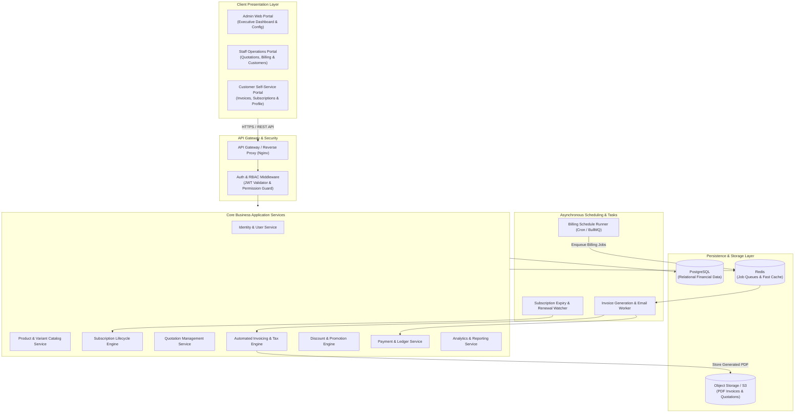
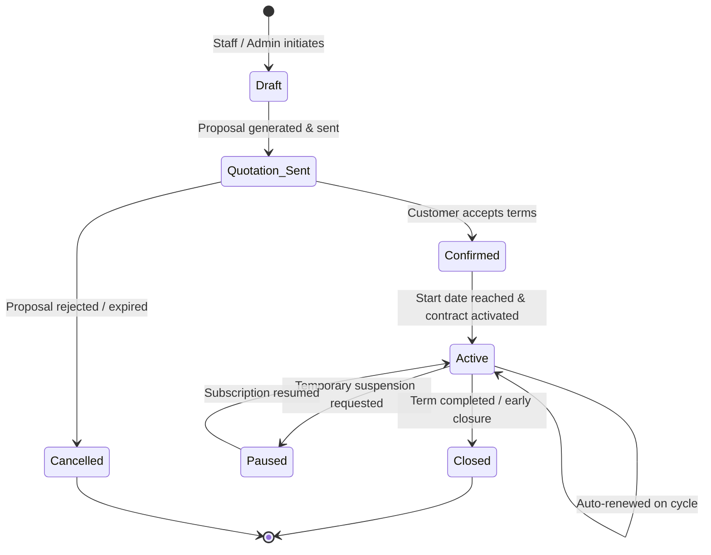
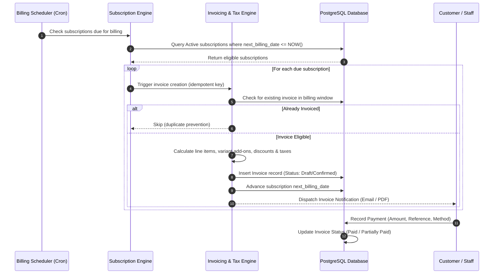
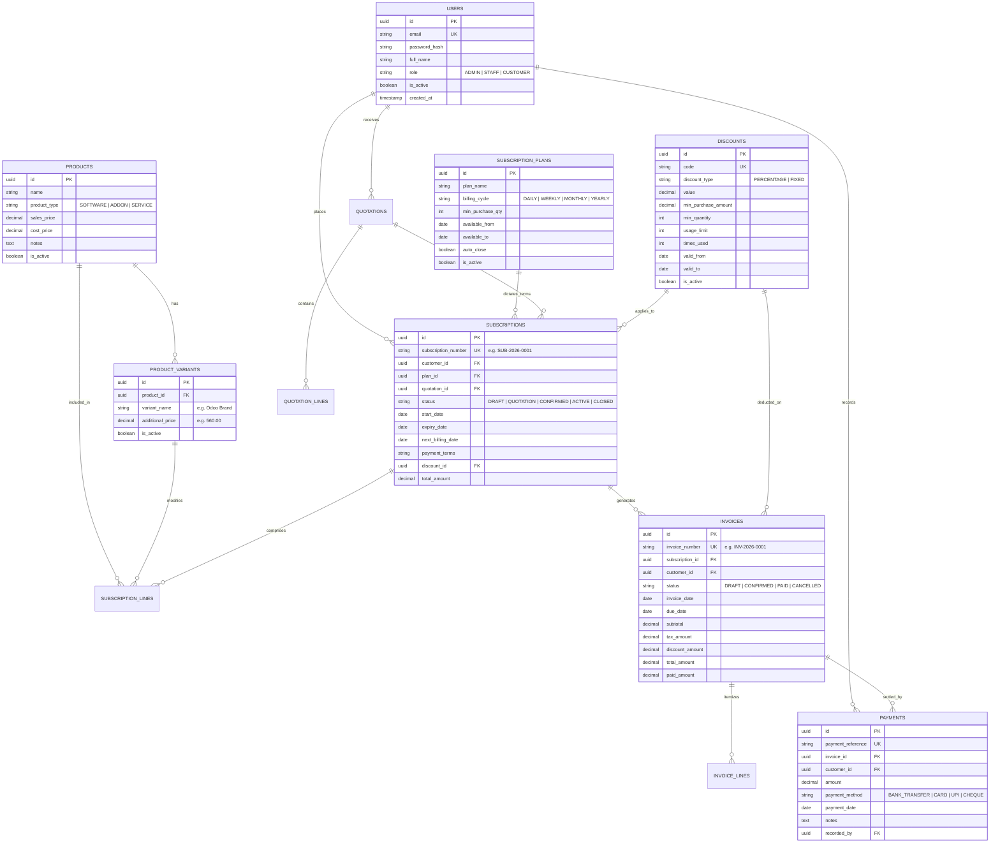

# 🔄 Subscription Management System – Brightloop Software

> **A unified, scalable subscription lifecycle, automated recurring billing, invoicing, and revenue analytics platform.**

[](https://github.com/abhin2003/subscript-hub)
[](https://github.com/abhin2003/subscript-hub)
[](#19-license)
[](#8-system-architecture)
[](#performance--scalability-standards)

---

## 📑 Table of Contents

- [1. Project Title and Introduction](#1-project-title-and-introduction)
- [2. Project Overview](#2-project-overview)
- [3. Problem Statement](#3-problem-statement)
- [4. Key Features](#4-key-features)
- [5. User Roles and Permissions](#5-user-roles-and-permissions)
- [6. System Modules](#6-system-modules)
  - [Module 1: Authentication & Role-Based Access Control](#module-1-authentication--role-based-access-control)
  - [Module 2: Product & Variant Management](#module-2-product--variant-management)
  - [Module 3: Subscription Plan Management](#module-3-subscription-plan-management)
  - [Module 4: Quotations & Subscription Management](#module-4-quotations--subscription-management)
  - [Module 5: Automated Invoicing & Tax Engine](#module-5-automated-invoicing--tax-engine)
  - [Module 6: Discount & Promotion Management](#module-6-discount--promotion-management)
  - [Module 7: Payment Tracking & Reconciliation](#module-7-payment-tracking--reconciliation)
  - [Module 8: Executive Dashboard & Revenue Analytics](#module-8-executive-dashboard--revenue-analytics)
- [7. Technology Stack](#7-technology-stack)
- [8. System Architecture](#8-system-architecture)
  - [High-Level Architectural Diagram](#high-level-architectural-diagram)
  - [Subscription Lifecycle State Machine](#subscription-lifecycle-state-machine)
  - [Invoicing & Payment Flow](#invoicing--payment-flow)
- [9. Project Folder Structure](#9-project-folder-structure)
- [10. Database Design & Entity Relationship Model](#10-database-design--entity-relationship-model)
- [11. Installation and Setup](#11-installation-and-setup)
- [12. Environment Variables](#12-environment-variables)
- [13. Running the Application Locally](#13-running-the-application-locally)
- [14. Available Scripts and Commands](#14-available-scripts-and-commands)
- [15. API Documentation](#15-api-documentation)
- [16. Application Screenshots & Mockups](#16-application-screenshots--mockups)
- [Performance & Scalability Standards](#performance--scalability-standards)
- [17. Future Enhancements](#17-future-enhancements)
- [18. Team and Contributors](#18-team-and-contributors)
- [19. License](#19-license)

---

## 1. Project Title and Introduction

**Subscription Management System** is an enterprise-grade digital platform engineered for **Brightloop Software**. Brightloop Software offers a rich catalog of software products, multi-tier software licenses, modular add-ons, and brand-specific variants.

This platform automates and centralizes every phase of the customer subscription journey: from prospect quotations and recurring contract execution to automated invoice generation, conditional discount application, tax computation, payment reconciliation, and real-time executive revenue analytics.

> **Development Status Note**: This repository (`abhin2003/subscript-hub`) is currently in its **Foundational Inception & Architecture Specification Phase**. This documentation serves as the blueprint, design guide, and technical specification for implementation.

---

## 2. Project Overview

Modern SaaS and subscription-driven businesses require strict financial precision, automated recurring schedules, and seamless quotation-to-cash workflows. **Brightloop Software** delivers solutions ranging from daily, weekly, monthly, and yearly recurring software licenses to customized add-on modules and brand variants.

The platform provides:
- **Centralized Product & Variant Cataloging**: Base pricing with dynamic variant uplifts (such as Odoo brand integrations).
- **Flexible Contract Cadences**: Granular billing frequencies with custom validity periods, minimum purchase limits, and renewal automation.
- **Automated Billing Pipeline**: Zero-human-intervention recurring invoicing that guarantees zero revenue leakage or duplicate billing.
- **Auditable Financial Workflows**: Full traceability across quotation templates, subscription agreements, tax-inclusive invoices, and partial/complete payment records.
- **Actionable Business Intelligence**: Deep visibility into Monthly Recurring Revenue (MRR), Annual Recurring Revenue (ARR), churn rates, outstanding receivables, and overdue collections.

---

## 3. Problem Statement

Prior to adopting a centralized subscription engine, Brightloop Software—like many growing subscription enterprises—faced operational friction from decentralized tools and manual tracking:

| Challenge | Impact on Business | System Solution |
| :--- | :--- | :--- |
| **Spreadsheet Billing** | Human error in date tracking, manual calculations, and missed renewal deadlines. | Fully automated, cron-driven subscription billing engine. |
| **Revenue Leakage** | Services delivered without corresponding invoices generated or sent. | Idempotent automated invoicing triggered on billing due dates. |
| **Variant Pricing Complexity** | Difficulties managing add-ons and brand variants (e.g., adding ₹560 for Odoo brand variants). | Explicit variant pricing schema that calculates aggregate line totals dynamically. |
| **Duplicate Invoicing** | Customers billed multiple times due to uncoordinated manual accounting runs. | Idempotency keys and invoice generation state locks. |
| **Uncontrolled Discounting** | Sales reps applying outdated or overlapping discounts without usage limit controls. | Rule-based discount validation engine with start/expiry dates and redemption caps. |
| **Blind Financial Visibility** | Inability to quickly compute net revenue, overdue aging, or active subscription health. | Real-time analytics dashboard with sub-two-second query response times. |

---

## 4. Key Features

```
┌────────────────────────────────────────────────────────────────────────┐
│               BRIGHTLOOP SUBSCRIPTION MANAGEMENT PLATFORM               │
└────────────────────────────────────────────────────────────────────────┘
  ├── 🔐 Secure RBAC (Admin, Staff, Customer with strict data isolation)
  ├── 📦 Multi-Variant Product Catalog (Base prices + variant adjustments)
  ├── ⏱️ Flexible Billing Cycles (Daily, Weekly, Monthly, Yearly)
  ├── 📝 Quotations & Contract Lifecycle (Draft → Quotation → Active → Closed)
  ├── ⚡ Automated Invoicing Engine (Due-date execution & tax computation)
  ├── 🏷️ Conditional Discount Engine (Fixed/Percentage, minimum orders, caps)
  ├── 💳 Payment Ledger & Aging Tracker (Payment recording & overdue flags)
  └── 📊 Revenue Analytics Dashboard (MRR, ARR, overdue aging, active units)
```

- **Robust Multi-Role Security**: Admin, Staff, and Customer personas with password complexity enforcement and self-service password reset.
- **Dynamic Product Modeling**: Support for standalone software plans, recurring add-ons, and multi-variant pricing rules.
- **Automated Recurring Invoicing**: Scheduled recurring billing jobs with automatic tax calculation and invoice status transitions (`Draft → Confirmed → Paid`).
- **Flexible Quotation System**: Reusable quotation templates with expiry dates that convert to confirmed subscriptions in one click.
- **Granular Discount Management**: Enforce minimum cart thresholds, validity windows, customer/product scopes, and total redemption counters.
- **Payment & Overdue Tracking**: Record split payments, monitor outstanding dues, and flag delinquent accounts automatically.
- **Sub-2-Second Performance SLA**: Database indexing, pagination, and query optimization designed to handle thousands of subscriptions with response times under two seconds.

---

## 5. User Roles and Permissions

The system enforces strict **Role-Based Access Control (RBAC)** across three primary user tiers:

```
               ┌───────────────────────┐
               │      Admin User       │
               │ (Full System Control) │
               └───────────┬───────────┘
                           │ creates & manages
                           ▼
               ┌───────────────────────┐
               │      Staff User       │
               │  (Operations & Sales) │
               └───────────┬───────────┘
                           │ serves & quotes
                           ▼
               ┌───────────────────────┐
               │     Customer User     │
               │ (Self-Service Portal) │
               └───────────────────────┘
```

| Feature / Capability | Admin 👑 | Staff 💼 | Customer 👤 | Notes |
| :--- | :---: | :---: | :---: | :--- |
| **User Management** | Full | View Only | None | Only Admins can provision Staff and Admin accounts |
| **Product & Variant Catalog** | Create / Edit / Delete | Create / Edit | Read Only | Customers see public pricing and applicable variants |
| **Subscription Plan Creation** | Create / Edit / Delete | Create / Edit | Read Only | Configure billing cycles, rules, and auto-closure |
| **Quotation Generation** | Full Access | Full Access | View Assigned | Customers can review and accept their quotations |
| **Subscription Operations** | Confirm / Pause / Cancel | Confirm / Pause | View Own | Customers can only view their active/past subscriptions |
| **Invoice Management** | Full (inc. Cancel/Delete) | Generate / Confirm / Send | View & Download | Customers can download PDF copies of their invoices |
| **Discount Rule Configuration** | Full Access | View / Apply | Redeem (if eligible) | Staff can apply active discounts during quotation creation |
| **Payment Recording** | Full Access | Record Payments | Make Payments / View | Staff and Admins record offline/online transactions |
| **Financial & Revenue Analytics**| Full Access | Operational Reports | None | Executive metrics (MRR/ARR) restricted to Admin |
| **Data Scope** | Global (All Tenants) | Global Operational | Tenant Isolated | Strict row-level security isolates customer records |

---

## 6. System Modules

### Module 1: Authentication & Role-Based Access Control
- **Account Registration & Login**: Unique email validation across all accounts.
- **Password Security Policy**: Minimum 8 characters with at least one uppercase letter, one lowercase letter, one numeric digit, and one special symbol (`!@#$%^&*`).
- **Secure Password Reset**: Time-limited cryptographic email tokens for self-service credential recovery.
- **Role Scoping**: Admin, Staff, and Customer roles. Administrative restriction ensures staff accounts cannot be self-registered.
- **Data Isolation**: Strict customer-level isolation ensuring customers cannot inspect sibling records.

### Module 2: Product & Variant Management
- **Product Entity**: Configurable product name, product type (Software, Add-On, Service), internal reference code, base sales price, cost price, and rich internal notes.
- **Variant Pricing Engine**: Dynamic attribute-based variant modifiers.
  - *Example*: Adding an **"Odoo Brand Variant"** applies an additional **+₹560** on top of the base product price.
- **Catalog Lifecycle**: Active/Inactive toggle states to archive legacy software offerings without breaking existing subscription history.

### Module 3: Subscription Plan Management
- **Billing Frequencies**: Daily, Weekly, Monthly, and Yearly recurring cycles.
- **Purchase Constraints**: Minimum purchase quantities and prerequisite add-on requirements.
- **Plan Validity**: Configurable plan availability windows (start date and end date).
- **Lifecycle Automations**:
  - Configurable automatic closure upon term expiry or payment default.
  - Manual suspension/pause options for seasonal holds.
  - Early contract closure with audit logging.
  - Automated or one-click subscription renewals.

### Module 4: Quotations & Subscription Management
- **Quotation Templates**: Reusable templates for standard service bundles, reducing proposal turnaround time.
- **Quotation Validity**: Configurable quotation expiry timers (e.g., valid for 15 or 30 days).
- **Subscription Identifier Generation**: Auto-generation of unique, sequential subscription codes (e.g., `SUB-2026-0001`).
- **Line Item Composition**: Product lines, selected variants, applied unit prices, quantity multipliers, applied taxes, and net line sums.
- **Subscription Lifecycle**:
  $$\text{Draft} \longrightarrow \text{Quotation Sent} \longrightarrow \text{Confirmed} \longrightarrow \text{Active} \longrightarrow \text{Closed / Renewed}$$

### Module 5: Automated Invoicing & Tax Engine
- **Automated Billing Engine**: Daily scheduled cron worker inspects active subscriptions and generates due invoices exactly on the billing cycle trigger date.
- **Data Propagation**: Copies customer billing coordinates, active product line items, variant surcharges, and applied discounts into an immutable invoice snapshot.
- **Tax Calculation Engine**: Automated regional tax calculation (e.g., GST / VAT percentages) computed at the line item and invoice level.
- **Lifecycle Operations**: Draft $\rightarrow$ Confirmed $\rightarrow$ Paid, with options to send email notices and generate printable PDF invoices.
- **Double-Billing Safeguard**: Unique composite constraints (`subscription_id` + `billing_period_start`) prevent duplicate invoices for the same interval.

### Module 6: Discount & Promotion Management
- **Discount Types**: Percentage-based discounts (e.g., 15% off) and fixed-amount discounts (e.g., ₹1,000 off).
- **Eligibility Rules**: Configurable minimum order values, minimum subscription quantities, and specific plan/product applicability.
- **Redemption Boundaries**: Start and expiry dates alongside maximum total usage counters (e.g., first 100 customers).
- **Billing Integration**: Real-time evaluation of discounts during quotation drafting and automated recurring billing runs.

### Module 7: Payment Tracking & Reconciliation
- **Payment Logging**: Record payments against specific invoices with payment method (Bank Transfer, Credit Card, UPI, Cheque), reference/transaction ID, payment date, and operational notes.
- **Balance Tracking**: Real-time computation of paid amounts versus outstanding balances.
- **Overdue Detection**: Automated detection and tagging of unpaid invoices past their payment terms (Net 15, Net 30, Due Upon Receipt).

### Module 8: Executive Dashboard & Revenue Analytics
- **Executive KPI Cards**: Total Active Subscriptions, Total Revenue Collected, Total Outstanding Receivables, and Overdue Invoice Count.
- **Revenue Metrics**: Monthly Recurring Revenue (MRR), Annual Recurring Revenue (ARR), and Churn rates.
- **Aging & Collections Report**: Breakdown of overdue receivables by age buckets (1–15 days, 16–30 days, 30+ days).
- **Filtering & Exporting**: Date range pickers, customer filtering, product-level revenue breakdowns, and CSV export capabilities.

---

## 7. Technology Stack

> **Current Implementation State**: The repository is currently in its initial architecture specification phase. The technology stack below is designed and recommended to satisfy the functional requirements, relational integrity constraints, and sub-two-second latency targets.

### Planned Production Technology Stack

| Layer | Recommended Technology | Justification & Architectural Role |
| :--- | :--- | :--- |
| **Backend Runtime** | **Node.js (TypeScript) / Express.js or NestJS** | Non-blocking I/O, enterprise modular architecture, robust typing for financial calculation logic. |
| **Frontend Framework** | **React / Next.js (TypeScript)** | Server-side rendering (SSR) for fast initial paint, reactive state management, and modern component architecture. |
| **Styling & UI System**| **Tailwind CSS + Headless UI / Lucide Icons** | Clean, accessible, responsive design system supporting high-density financial data tables and dashboards. |
| **Primary Database** | **PostgreSQL (v15+)** | ACID compliance, strict relational foreign keys, row-level locking, and high-performance financial transactions. |
| **Caching & Job Queue**| **Redis + BullMQ** | Reliable distributed queue for recurring invoice generation, background billing jobs, and session caching. |
| **Authentication** | **JWT (JSON Web Tokens) + Argon2 / bcrypt** | Stateless authentication tokens, secure refresh rotation, and high-entropy password hashing. |
| **PDF Generation** | **Puppeteer / React-PDF** | High-fidelity invoice and quotation PDF rendering for printing and customer email dispatch. |
| **Testing Suite** | **Jest / Vitest + Supertest + Playwright** | Unit tests for financial calculations, integration tests for billing runs, and end-to-end UI tests. |

---

## 8. System Architecture

### High-Level Architectural Diagram



### Subscription Lifecycle State Machine



### Invoicing & Payment Flow



---

## 9. Project Folder Structure

The planned modular folder structure for the application implementation:

```
subscript-hub/
├── .github/
│   └── workflows/
│       ├── ci.yml                     # Automated testing & linting pipeline
│       └── deploy.yml                 # Deployment automation workflow
├── docs/
│   ├── architecture.md               # Detailed architectural specs
│   ├── database-schema.sql           # Canonical DDL schema script
│   └── api-spec.json                 # OpenAPI / Swagger 3.0 specification
├── client/                           # Frontend Web Application (React / Next.js)
│   ├── public/                       # Static public assets (logos, icons)
│   ├── src/
│   │   ├── assets/                   # Images and styling assets
│   │   ├── components/               # Reusable UI components
│   │   │   ├── common/               # Buttons, Inputs, Modals, Tables
│   │   │   ├── dashboard/            # Metric cards, Revenue charts
│   │   │   ├── invoices/             # Invoice tables, PDF view, Status badges
│   │   │   ├── products/             # Product forms, Variant pickers
│   │   │   └── subscriptions/        # Plan cards, Lifecycle controls
│   │   ├── context/                  # React Auth and Theme context
│   │   ├── hooks/                    # Custom React hooks (useAuth, useFetch)
│   │   ├── pages/                    # Route page views
│   │   ├── services/                 # API client services (Axios / Fetch)
│   │   ├── types/                    # Frontend TypeScript interfaces
│   │   └── utils/                    # Formatting (currency, date calculations)
│   ├── package.json
│   ├── tailwind.config.js
│   └── tsconfig.json
├── server/                           # Backend Application Server (Node / Express / Nest)
│   ├── src/
│   │   ├── config/                   # Database, Redis, and app environment config
│   │   ├── constants/                # Enums (Roles, SubscriptionStatus, InvoiceStatus)
│   │   ├── controllers/              # HTTP Request handlers
│   │   │   ├── auth.controller.ts
│   │   │   ├── product.controller.ts
│   │   │   ├── plan.controller.ts
│   │   │   ├── quotation.controller.ts
│   │   │   ├── subscription.controller.ts
│   │   │   ├── invoice.controller.ts
│   │   │   ├── discount.controller.ts
│   │   │   ├── payment.controller.ts
│   │   │   └── analytics.controller.ts
│   │   ├── middleware/               # Auth guards, RBAC, input validators
│   │   │   ├── auth.middleware.ts
│   │   │   ├── rbac.middleware.ts
│   │   │   └── error.middleware.ts
│   │   ├── models/                   # Database models / ORM entities
│   │   ├── routes/                   # API endpoint route definitions
│   │   ├── services/                 # Core business logic services
│   │   │   ├── billing-engine.service.ts
│   │   │   ├── tax-calculator.service.ts
│   │   │   └── discount-evaluator.service.ts
│   │   ├── jobs/                     # Cron workers (recurring billing, renewals)
│   │   ├── utils/                    # Financial rounding, PDF generator, token utils
│   │   └── app.ts                    # Express app initialization
│   ├── tests/                        # Unit, integration, and E2E test suites
│   ├── package.json
│   └── tsconfig.json
├── docker-compose.yml                # Local multi-container development environment
├── .env.example                      # Template environment variables
├── .gitignore                        # Git ignore rules
├── LICENSE                           # Software License (MIT)
└── README.md                         # Project documentation
```

---

## 10. Database Design & Entity Relationship Model

The schema enforces strict referential integrity, financial precision (using numeric/decimal types), and comprehensive audit trails.



---

## 11. Installation and Setup

### Prerequisites

Ensure you have the following software installed on your development workstation:
- **Git** (v2.30 or higher)
- **Node.js** (v18.x or v20.x LTS) & **npm** / **yarn** / **pnpm**
- **PostgreSQL** (v14 or higher)
- **Redis** (v6.x or higher, for background jobs and caching)
- *(Optional)* **Docker & Docker Compose** (for automated containerized dependencies)

### Step 1: Clone the Repository

```bash
git clone https://github.com/abhin2003/subscript-hub.git
cd subscript-hub
```

### Step 2: Environment Configuration

Copy the example environment configuration file to create your local `.env`:

```bash
cp .env.example .env
```

Review and update the database credentials, port bindings, and JWT secret tokens in `.env`.

### Step 3: Install Dependencies

```bash
# Install backend service dependencies
cd server
npm install

# Install frontend application dependencies
cd ../client
npm install
```

### Step 4: Database Provisioning & Migrations

Ensure your PostgreSQL service is running, create the database, and execute the migration scripts:

```bash
# In the server directory
npm run db:create
npm run db:migrate
npm run db:seed      # Seeds initial Admin account and product plans
```

---

## 12. Environment Variables

Create a `.env` file in the project root or respective service directories based on this reference:

```ini
# ==============================================================================
# BRIGHTLOOP SUBSCRIPTION MANAGEMENT SYSTEM - CONFIGURATION
# ==============================================================================

# Application Environment
NODE_ENV=development
PORT=5000
CLIENT_URL=http://localhost:3000

# Security & Authentication
JWT_SECRET=super_secret_cryptographic_key_change_in_production
JWT_EXPIRATION=1d
JWT_REFRESH_SECRET=super_refresh_cryptographic_key_change_in_production
JWT_REFRESH_EXPIRATION=7d

# Database Configuration (PostgreSQL)
DB_HOST=localhost
DB_PORT=5432
DB_NAME=subscript_hub_db
DB_USER=postgres
DB_PASSWORD=your_secure_password
DB_SSL=false
DB_POOL_MAX=20

# Cache & Message Broker (Redis)
REDIS_HOST=localhost
REDIS_PORT=6379
REDIS_PASSWORD=

# Automated Invoicing & Scheduler Settings
BILLING_CRON_SCHEDULE="0 0 * * *"      # Runs daily at midnight UTC
INVOICE_DUE_DAYS=15                    # Default invoice due date period
DEFAULT_TAX_PERCENTAGE=18.00           # Default GST / Tax rate

# Email / Notification Gateway (SMTP)
SMTP_HOST=smtp.mailtrap.io
SMTP_PORT=2525
SMTP_USER=your_smtp_username
SMTP_PASS=your_smtp_password
EMAIL_FROM="Brightloop Software <billing@brightloop.io>"
```

---

## 13. Running the Application Locally

### Running with Local Node & PostgreSQL Services

You can run both the server API and the client application concurrently:

```bash
# Terminal 1: Run Backend API Server
cd server
npm run dev

# Terminal 2: Run Background Billing Job Worker
cd server
npm run worker:dev

# Terminal 3: Run Frontend Web Application
cd client
npm run dev
```

Once started:
- **Frontend Dashboard**: Open your browser to `http://localhost:3000`
- **Backend REST API**: Running at `http://localhost:5000/api/v1`
- **API Health Check**: `http://localhost:5000/api/v1/health`

### Running via Docker Compose *(Planned Setup)*

```bash
# Launch PostgreSQL, Redis, Backend API, Worker, and Frontend in one command
docker-compose up --build
```

---

## 14. Available Scripts and Commands

### Backend (`/server`)

| Command | Description |
| :--- | :--- |
| `npm run dev` | Starts the server in development mode with hot-reloading (`ts-node-dev`). |
| `npm run build` | Compiles TypeScript source files into production-ready JavaScript (`dist/`). |
| `npm start` | Launches the compiled production application. |
| `npm run worker:dev`| Starts the BullMQ / Redis background worker for recurring billing jobs. |
| `npm run db:migrate`| Applies pending database migrations to PostgreSQL. |
| `npm run db:seed` | Populates the database with default admin credentials, roles, and plans. |
| `npm test` | Executes unit and integration test suites with coverage reports. |
| `npm run lint` | Runs ESLint and Prettier for code style and syntax consistency. |

### Frontend (`/client`)

| Command | Description |
| :--- | :--- |
| `npm run dev` | Launches the Next.js / Vite development server with Fast Refresh. |
| `npm run build` | Builds an optimized production bundle. |
| `npm start` | Starts the production Next.js server. |
| `npm run lint` | Inspects frontend code for React and TypeScript linting issues. |

---

## 15. API Documentation

All API endpoints are prefixed with `/api/v1` and require a valid Bearer JWT header unless marked as **Public**.

### Authentication Endpoints
- `POST /api/v1/auth/register` – Public customer registration.
- `POST /api/v1/auth/login` – Authenticate with email/password and obtain JWT tokens.
- `POST /api/v1/auth/forgot-password` – Request a time-limited password recovery email.
- `POST /api/v1/auth/reset-password` – Submit new password with reset token.
- `POST /api/v1/auth/staff` – **(Admin Only)** Create a Staff member account.

### Product & Variant Endpoints
- `GET /api/v1/products` – List active products with pricing and variant options.
- `POST /api/v1/products` – **(Admin/Staff)** Create a product (name, type, sales price, cost price).
- `PUT /api/v1/products/:id` – **(Admin/Staff)** Update an existing product.
- `POST /api/v1/products/:id/variants` – **(Admin/Staff)** Attach a variant (e.g. Odoo brand +₹560).
- `DELETE /api/v1/products/:id` – **(Admin Only)** Soft-delete/deactivate a product.

### Subscription Plan Endpoints
- `GET /api/v1/plans` – Retrieve subscription plans (Daily, Weekly, Monthly, Yearly).
- `POST /api/v1/plans` – **(Admin/Staff)** Create a new subscription plan with constraints.
- `PUT /api/v1/plans/:id` – **(Admin/Staff)** Edit plan parameters, validity dates, or auto-closure.

### Quotations & Subscriptions Endpoints
- `GET /api/v1/quotations` – List quotations (filtered by customer for Customer role).
- `POST /api/v1/quotations` – **(Staff/Admin)** Generate a quotation from template.
- `POST /api/v1/quotations/:id/confirm` – Convert quotation into a confirmed subscription.
- `GET /api/v1/subscriptions` – Paginated list of subscriptions with lifecycle filters.
- `GET /api/v1/subscriptions/:id` – Get subscription details, line items, and schedule.
- `POST /api/v1/subscriptions/:id/pause` – **(Admin/Staff)** Temporarily pause an active subscription.
- `POST /api/v1/subscriptions/:id/close` – **(Admin/Staff)** Close a subscription early.
- `POST /api/v1/subscriptions/:id/renew` – Renew a subscription for another billing cycle.

### Invoicing & Billing Endpoints
- `GET /api/v1/invoices` – List invoices with payment statuses (`Draft`, `Confirmed`, `Paid`).
- `GET /api/v1/invoices/:id` – Retrieve invoice details with tax and discount breakdowns.
- `GET /api/v1/invoices/:id/pdf` – Download generated printable PDF invoice.
- `POST /api/v1/invoices/run-billing` – **(Admin Only)** Manually trigger the recurring billing worker.
- `POST /api/v1/invoices/:id/cancel` – **(Admin Only)** Cancel an issued invoice.

### Discounts & Payments Endpoints
- `GET /api/v1/discounts` – **(Admin/Staff)** List available discounts and usage counters.
- `POST /api/v1/discounts` – **(Admin Only)** Create fixed or percentage discount rules.
- `POST /api/v1/payments` – **(Admin/Staff)** Record a payment against an invoice.
- `GET /api/v1/payments/overdue` – **(Admin/Staff)** Retrieve report of overdue balances.

### Analytics Endpoints
- `GET /api/v1/analytics/overview` – **(Admin Only)** Active subscriptions, revenue, outstanding dues.
- `GET /api/v1/analytics/revenue-trends` – **(Admin Only)** MRR, ARR, and collection timeseries.

---

## 16. Application Screenshots & Mockups

Below are the interface mockups and workflow wireframes designed for the Brightloop platform:

### 1. Executive Revenue & Operations Dashboard
```
+-----------------------------------------------------------------------------------------+
| BRIGHTLOOP SOFTWARE  |  Dashboard   Subscriptions   Invoices   Products   Discounts     |
+-----------------------------------------------------------------------------------------+
|  ACTIVE SUBSCRIPTIONS  |  TOTAL REVENUE COLLECTED  |  OUTSTANDING DUES  |  OVERDUE INVOICES |
|        1,428           |        Rs. 8,42,900       |    Rs. 1,12,400    |        19         |
|     (+12% this mo)     |      (+8.4% vs target)    |   (14 accounts)    |  (Action Needed)  |
+-----------------------------------------------------------------------------------------+
|  [ Revenue Trend Chart (MRR / ARR) ]           |  [ Aging of Receivables Breakdown ]     |
|   Rs. 10L |         *---*                      |    0-15 Days : [=================] 65%  |
|    Rs. 8L |     *--*                           |   16-30 Days : [======] 22%             |
|    Rs. 6L |  *-*                               |     30+ Days : [===] 13%                |
|           +-----------------------             |                                         |
|             Jan  Feb  Mar  Apr                 |                                         |
+-----------------------------------------------------------------------------------------+
```

### 2. Subscription Lifecycle & Line Items Manager
```
+-----------------------------------------------------------------------------------------+
| SUBSCRIPTION: SUB-2026-0042  |  Status: [ ACTIVE ]  |  Cycle: Monthly  |  Terms: Net 15  |
+-----------------------------------------------------------------------------------------+
| Customer: Acme Enterprise Solutions (contact@acme.com)                                  |
| Period: 01 Nov 2026 - 30 Nov 2026      | Next Billing Date: 01 Dec 2026                 |
+-----------------------------------------------------------------------------------------+
| #  | Product Item              | Variant       | Qty | Unit Price | Tax (18%) | Total   |
|----+---------------------------+---------------+-----+------------+-----------+---------|
| 01 | Brightloop Core SaaS      | Standard      |  10 |  Rs. 1,200 |  Rs. 2,160|Rs.14,160|
| 02 | Odoo Sync Connector Addon | Odoo Brand (+)|  10 |  Rs.   560 |  Rs. 1,008|Rs. 6,608|
+-----------------------------------------------------------------------------------------+
| Subtotal: Rs. 17,600  |  Discount (PROMO10): -Rs. 1,760  |  Tax: Rs. 2,851  | Total: Rs. 18,691 |
+-----------------------------------------------------------------------------------------+
| [ Pause Subscription ]    [ Early Closure ]    [ Generate Immediate Invoice ]    [ Renew ]  |
+-----------------------------------------------------------------------------------------+
```

---

## Performance & Scalability Standards

To fulfill the mission-critical business requirements, the application adheres to strict performance baselines:

1. **Sub-Two-Second Response Times**:
   - Every read and write API endpoint is indexed and tuned to respond in **under 2.0 seconds** under concurrent loads.
   - Heavy financial aggregations are pre-computed using materialized reporting tables or cached in Redis.
2. **High-Throughput Subscription Support**:
   - Architecture capable of handling **thousands of active subscriptions** without performance degradation.
   - Batching and cursor pagination (`limit` & `offset` / keyset pagination) implemented on all entity lists.
3. **Billing Idempotency & Fault Tolerance**:
   - Recurring billing runs are wrapped in ACID database transactions with distributed Redis locks to ensure that network interruptions or worker restarts **never generate duplicate invoices**.

---

## 17. Future Enhancements

The platform technical roadmap includes:
- [ ] **Payment Gateway Integration**: Direct automated recurring credit card debits via Stripe Billing and Razorpay Subscriptions.
- [ ] **Automated Dunning Management**: Intelligent retry logic and escalation workflows for failed customer recurring charges.
- [ ] **Multi-Currency Support**: Automatic FX conversion for international clients purchasing in USD, EUR, and GBP.
- [ ] **Customer Self-Service Plan Upgrades**: Self-serve portal allowing customers to add licenses or upgrade variants mid-cycle with pro-rated billing.
- [ ] **Webhook Infrastructure**: Webhook dispatching for external ERP/CRM synchronization on subscription and invoice events.

---

## 18. Team and Contributors

Developed and maintained for **Brightloop Software**:

- **Abhinav** ([@abhin2003](https://github.com/abhin2003)) – *Project Lead & Architecture*
- **Brightloop Software Engineering Team**

---

## 19. License

This project is licensed under the **MIT License**. See the [LICENSE](LICENSE) file for more information.

```
Copyright (c) 2026 Brightloop Software

Permission is hereby granted, free of charge, to any person obtaining a copy
of this software and associated documentation files (the "Software"), to deal
in the Software without restriction, including without limitation the rights
to use, copy, modify, merge, publish, distribute, sublicense, and/or sell
copies of the Software, and to permit persons to whom the Software is
furnished to do so, subject to the following conditions:

The above copyright notice and this permission notice shall be included in all
copies or substantial portions of the Software.
```
